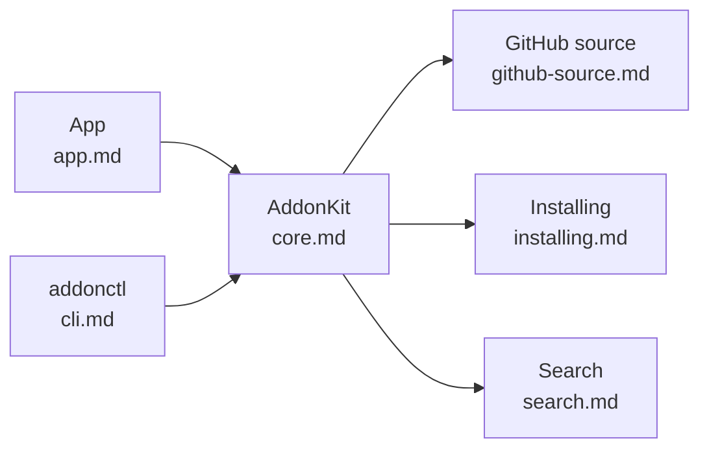

# ForeverAddons docs

| Doc | Covers |
|---|---|
| [design.md](design.md) | The original design and architecture: goals, sources, data model, every component, milestones |
| [core.md](core.md) | The AddonKit library and `AddonManager`, the API both front ends use |
| [github-source.md](github-source.md) | How the Forever release and zip are chosen on GitHub |
| [installing.md](installing.md) | Downloads, safe installs, the install records, finding WoW |
| [search.md](search.md) | Search layers, ranking, Forever support checks, Browse |
| [app.md](app.md) | The SwiftUI app: Xcode project, data, live updates, CLI install |
| [cli.md](cli.md) | `addonctl` commands, options, exit codes |
| [development.md](development.md) | Building, testing and conventions |

