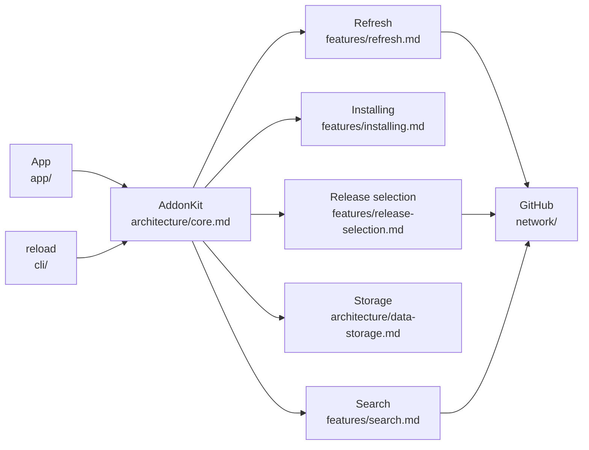

# Reload docs

Index of every doc, with a line on when to read it. Load only the files you need.

New here? Start with [overview.md](overview.md). Working on the code? [development.md](development.md).

## Start here

| Doc | Read this when… |
|---|---|
| [overview.md](overview.md) | you want to know what the app is and how the app, CLI and core fit together |
| [development.md](development.md) | you're building, testing or running the app safely, or need the conventions |

## architecture/

| Doc | Read this when… |
|---|---|
| [core.md](architecture/core.md) | you need the `AddonManager` API, the component map or the source layout |
| [data-storage.md](architecture/data-storage.md) | you need to know where a file lives, how the install store locks, or the SQLite schema, migrations and change stream |
| [concurrency.md](architecture/concurrency.md) | you're adding shared state, an actor, or code that must run off the main thread |
| [flavors.md](architecture/flavors.md) | you need the per-game flavor table (Forever, Retail, the classics), game families (R / F / C), TOC suffix rules or `release.json` / TOC parsing |
| [errors.md](architecture/errors.md) | you're adding or handling an `AddonError`, or mapping one to a CLI exit code |

## features/

| Doc | Read this when… |
|---|---|
| [release-selection.md](features/release-selection.md) | you need to know how a Forever release and zip are chosen, or what support checks return |
| [installing.md](features/installing.md) | you're changing install, update, rollback, uninstall, or the downloader |
| [finding-wow.md](features/finding-wow.md) | WoW isn't detected, or you're changing installation detection, folder mappings or IDs |
| [search.md](features/search.md) | you're changing search layers, ranking, aliases, the GitHub fallback, catalogue import or Browse |
| [refresh.md](features/refresh.md) | you're changing the background refresh: its phases, targets, politeness or progress |
| [dependencies.md](features/dependencies.md) | you're working on required add-ons: missing-dependency warnings, installing them alongside, or the removal guard |
| [sources.md](features/sources.md) | you're working on GitHub, WoWInterface or Tukui as sources, hosted listings, `AddonRef.key`, or turning sources on and off |
| [details-and-screenshots.md](features/details-and-screenshots.md) | you're working on the inspector, where its details come from, README fetching and rendering, or screenshots |

## network/

| Doc | Read this when… |
|---|---|
| [overview.md](network/overview.md) | **before any change that makes requests**: when the network is used and the rules |
| [github-endpoints.md](network/github-endpoints.md) | you need a URL, its quota cost, the headers or the error mapping |
| [caching.md](network/caching.md) | you're adding a cache, a TTL, or deciding freshness (`CachePolicy`) |
| [budget.md](network/budget.md) | you want requests per user action: baseline, measured now, and after the latest fixes |

## performance/

| Doc | Read this when… |
|---|---|
| [measurements.md](performance/measurements.md) | you want measured numbers (baseline and latest) for launch, memory, search, SQLite, zips |
| [guidelines.md](performance/guidelines.md) | **before changing hot paths, tables or database code** |

## app/

| Doc | Read this when… |
|---|---|
| [project.md](app/project.md) | you're changing the Xcode project, targets, the embedded CLI or `RELOAD_DATA_DIR` |
| [releases.md](app/releases.md) | you're cutting a release, or setting up signing and notarization |
| [layout.md](app/layout.md) | you're working on the window, toolbar, inspector placement, tables, sorting or the add-on window |
| [navigation.md](app/navigation.md) | you're working on the game picker, the sidebar's sections, counts and categories, or what search applies to |
| [first-launch.md](app/first-launch.md) | you're touching the seeding sheet, refresh progress or the 2-hour auto refresh |
| [live-data.md](app/live-data.md) | you're changing how the app follows database changes, CLI writes or the install store |
| [settings.md](app/settings.md) | you're changing the Settings window, a setting's key, or the app icon picker |
| [network-activity.md](app/network-activity.md) | you're working on Window ▸ Network Activity, or how the core records requests and downloads |
| [cli-install.md](app/cli-install.md) | you're changing how the app installs `reload` into `/usr/local/bin` |

## cli/

| Doc | Read this when… |
|---|---|
| [commands.md](cli/commands.md) | you need a command, how `<ref>` resolves, or how the installation is picked |
| [output.md](cli/output.md) | you're changing tables, JSON, progress, exit codes, environment or completions |
| [maintenance.md](cli/maintenance.md) | you're using or changing `refresh`, `cache` or `doctor` |
| [config.md](cli/config.md) | you need config keys, the `addons.json` format or current limits |

## decisions/

| Doc | Read this when… |
|---|---|
| [README.md](decisions/README.md) | you want to know *why* something is the way it is, or need to record a new decision |
| [0000-original-design.md](decisions/0000-original-design.md) | you want the original goals, milestones and source research (historical) |
