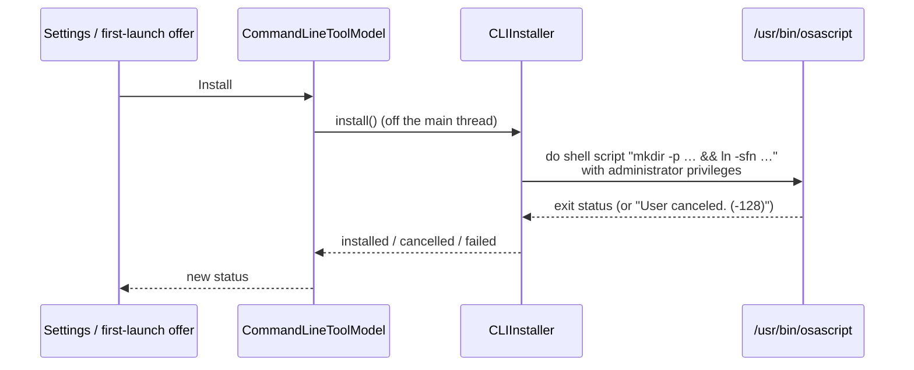

# CLI install from the app

How the app puts its bundled `reload` on the `PATH`: the first-launch offer, the admin-prompt symlink, the Settings section and the uninstall rules.

Code: `App/Reload/Support/CLIInstaller.swift`, `Models/CommandLineToolModel.swift`, `Views/CommandLineToolViews.swift`. Why: [decision 0006](../decisions/0006-bundled-cli-install.md). The CLI itself: [cli/commands.md](../cli/commands.md).

## What gets installed

```
/usr/local/bin/reload  →  <app>/Contents/Helpers/reload
```

- A **symlink**, so updating the app updates the tool.
- `/usr/local/bin` is on the default `PATH`.
- In Debug builds run from Xcode the helper lives in DerivedData, so the link points there.

## How it's created



- Creating the link needs admin rights, so it runs `do shell script … with administrator privileges`, which shows the standard macOS password prompt.
- It runs **`/usr/bin/osascript` as a subprocess, off the main thread.** It used to use `NSAppleScript` on the main thread, which froze the UI while the prompt was up.
- Cancelling the prompt leaves things as they were.
- The privileged runner is injectable, so tests never prompt. Never run the real admin prompt from an agent or test.

## First-launch offer

- Shown once, after the seeding sheet closes ([first-launch.md](first-launch.md)), unless the tool is already installed.
- Buttons: **Install** and **Not Now**. Either way it's remembered in user defaults as `didOfferCommandLineTool` and not repeated.
- Only appears on real data, not with `RELOAD_DATA_DIR`.
- To reset: Settings ▸ Advanced ▸ **Reset first-launch steps**, or `defaults delete com.andrewmiotke.Reload didOfferCommandLineTool`.

## Settings ▸ Command Line

`CLIInstaller.status()` reads the link without admin rights:

| Status | Meaning | Install button | Uninstall button |
|---|---|---|---|
| `notInstalled` | nothing at the path | Install | disabled |
| `installed` | links to this app's helper | disabled | removes the link |
| `otherCopy` | links into another `Reload.app` | Repair (relinks) | removes the link |
| `foreign` | a real file, or a link elsewhere | Replace | disabled (the core refuses with `notOurs`) |

## Uninstall rules

- Uninstall **only removes a link that points into a `Reload.app` bundle.** A real file or a link to anything else at that path is left alone.
- Even then the command is `if [ -L <path> ]; then rm -f <path>; fi`, so it can never delete a real file.
- It uses the same admin prompt as install. After install or uninstall the status is read again to confirm.

## Without the app

`swift build -c release --product reload`, then put `.build/release/reload` on your `PATH` ([cli/commands.md](../cli/commands.md#installing-it)).
