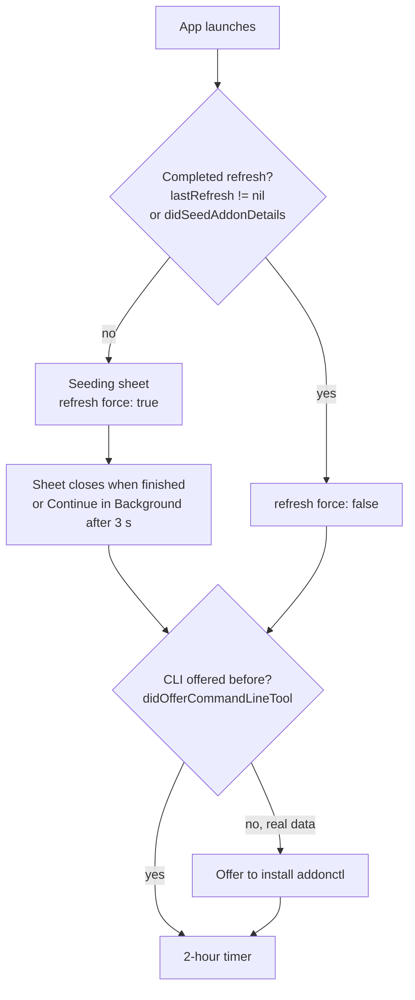

# First launch and refresh

What happens the first time the app opens (the seeding sheet and the CLI offer), and how refreshes run afterwards: progress, the 2-hour timer and manual checks.

Code: `App/ForeverAddons/Models/AppModel.swift`, `Views/SeedingSheet.swift`. What the core's refresh does: [features/refresh.md](../features/refresh.md).

## Sequence

## Seeding sheet

- Shown when no refresh has ever completed: `lastRefresh(in:) == nil` and no `didSeedAddonDetails` flag.
- Title "Gathering Add-on Details". It blocks the window with a determinate progress bar, the current step and "n of m".
- It closes when the refresh finishes. After 3 seconds, **Continue in Background** lets you in while it keeps going.
- On sandboxed data (`ADDONS_DATA_DIR`) the flag isn't stored, so only `lastRefresh` decides.
- To see it again: Settings ▸ Advanced ▸ **Reset first-launch steps** ([settings.md](settings.md#advanced)), or `defaults delete com.andrewmiotke.ForeverAddons didSeedAddonDetails`.

## Refresh progress

`refresh` emits `RefreshProgress` through its phases (catalogue, updates, support), then `.finished` ([phases](../features/refresh.md#flow)). The app uses `fraction` for the bar.

- `.finished` carries the update states, which replace the Installed statuses.
- During the support phase Browse games update live from database changes ([live-data.md](live-data.md)), with one full Browse re-read at the end.
- Progress lives in `RefreshStatus`, observed only by the sidebar bar and the seeding sheet.

### Sidebar progress

While a refresh reports progress, a small bar and message sit at the bottom of the sidebar. Throttled refreshes that finish at once never show it.

## When refreshes run

| Trigger | Call |
|---|---|
| First launch | `refresh(force: true)` behind the seeding sheet |
| Launch, app activation, every 2 h while running | `refresh(force: false)`; the core throttles it, so it's cheap |
| Check for Updates (⌘R, toolbar, menu bar extra) | `refresh(force: true)` |

- The 2-hour timer is one task, restarted when the selected installation changes and skipped while a refresh is running.
- Automatic refreshes can be turned off in Settings (**Check for updates automatically**, key `checkForUpdatesOnLaunch`).

## CLI install offer

After the seeding sheet closes, the app offers once to install `addonctl` (unless it's already installed). Only on real data. Details: [cli-install.md](cli-install.md).
