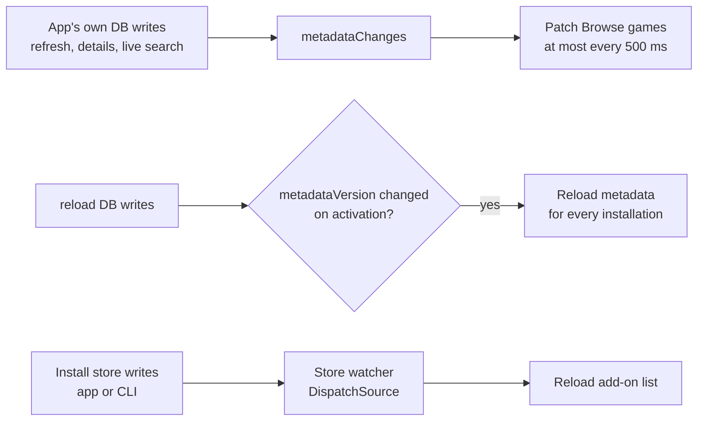

# Live data in the app

How the app stays current without polling: change events for its own metadata writes, the metadata version for the CLI's writes, and the store watcher for installs. All three come through `AddonManaging` (`metadataChanges()`, `metadataVersion()`, `storeDirectory`); the app never opens the database or the store itself.

Code: `App/Reload/Models/AppModel.swift`, `Models/LiveMetadata.swift`, `Models/BrowseModel.swift`, `Support/DirectoryWatcher.swift`. The database side: [data-storage.md](../architecture/data-storage.md#change-stream).

## Three sources of change

| Change | Detected by | What reloads |
|---|---|---|
| The app's own metadata writes (refresh, details, live search, visible-row checks) | `metadataChanges()` | Games and verdicts on the rows currently shown |
| `reload` metadata writes | `metadataVersion()` (`PRAGMA data_version`), compared on app activation | Metadata for every installation model |
| Install store writes (app or CLI) | the store watcher | The add-on list |

## Live games during a refresh

- `LiveMetadata`, owned by each installation's `BrowseModel`, listens to `metadataChanges()` for the `support` and `catalogue` kinds.
- Changed repos are collected and patched in **at most twice a second** (`LiveMetadata.interval`, 500 ms), because a refresh writes one verdict per repo.
- Only what's on screen is patched: the search results, the Browse home lists and the inspector's loaded details (`InspectorModel.applyStored`), so installing an add-on updates its header's games along with its row. Their stored verdicts and available flavors are read back in one `storedAvailability(for:in:)` call (one SQL query however many rows) and applied with `patching`.
- If a catalogue change touches a repo on the home lists, or a change carries no repo list, the Browse lists are re-read.
- When the refresh finishes, Browse is re-read once in full.

## The CLI's metadata writes

- `metadataChanges()` only sees writes made through this process's connection.
- So on app activation, `AppModel.reloadMetadataIfChanged()` compares `metadataVersion()` with the last value it saw. Only if it changed does each installation's `BrowseModel.reloadMetadata()` run.
- That catches `reload refresh`, `reload info` (which stores details) and `reload cache clear --metadata`.

## Live updates from `reload` installs

- The app watches the store folder (`AddonManaging.storeDirectory`) with a `DispatchSource` and reloads, debounced, when it changes. Add-ons installed or updated from the terminal show up immediately.
- Store-watcher reloads only re-read the add-on list, never the network.
- They're skipped when the folder's fingerprint (paths, sizes, modification dates) matches the last reload, which is what happens after the app's own writes.
- The app also reloads the add-on list whenever it becomes active.

## Rules

- Never poll the database on a timer.
- Patch rows in place rather than reloading lists; per-row state keeps re-renders local ([performance/guidelines.md](../performance/guidelines.md#progress-and-observation)).
- Assign model properties only when the value changed.
