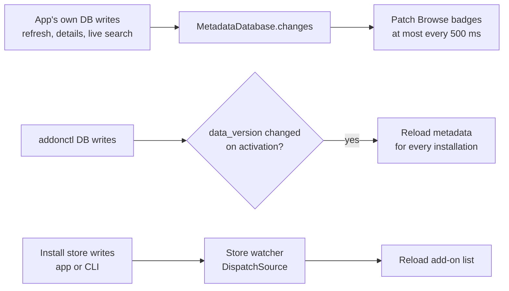

# Live data in the app

How the app stays current without polling: database change events for its own writes, `PRAGMA data_version` for the CLI's metadata writes, and the store watcher for installs.

Code: `App/ForeverAddons/Models/AppModel.swift`, `Models/InstallationModel.swift`, `Support/DirectoryWatcher.swift`. The database side: [data-storage.md](../architecture/data-storage.md#change-stream).

## Three sources of change

| Change | Detected by | What reloads |
|---|---|---|
| The app's own metadata writes | `MetadataDatabase.changes()` | Badges on the rows currently shown |
| `addonctl` metadata writes | `PRAGMA data_version`, compared on app activation | Metadata for every installation model |
| Install store writes (app or CLI) | the store watcher | The add-on list |

## Live badges during a refresh

- `InstallationModel` listens to `changes()` for the `support`, `repo_meta` and `catalogue` tables.
- Changed repos are collected and patched in **at most twice a second** (`livePatchInterval`, 500 ms), because a refresh writes one verdict per repo.
- Only rows on screen are patched: the search results and the Browse home lists. Each one reads its stored verdict back through `SupportCache`.
- If a catalogue change touches a repo on the home lists, or a change carries no repo list, the Browse lists are re-read.
- When the refresh finishes, Browse is re-read once in full.

## The CLI's metadata writes

- `changes()` only sees writes made through this process's connection.
- So on app activation, `AppModel.reloadMetadataIfChanged()` compares `dataVersion()` (`PRAGMA data_version`) with the last value it saw. Only if it changed are the installation models' metadata reloaded.
- That catches `addonctl refresh`, `addonctl info` (which stores details) and `addonctl cache clear --metadata`.

## Live updates from `addonctl` installs

- The app watches the store folder (`InstallStore.storeDirectory`) with a `DispatchSource` and reloads, debounced, when it changes. Add-ons installed or updated from the terminal show up immediately.
- Store-watcher reloads only re-read the add-on list, never the network.
- They're skipped when the folder's fingerprint (paths, sizes, modification dates) matches the last reload, which is what happens after the app's own writes.
- The app also reloads the add-on list whenever it becomes active.

## Rules

- Never poll the database on a timer.
- Patch rows in place rather than reloading lists; per-row state keeps re-renders local ([performance/guidelines.md](../performance/guidelines.md#progress-and-observation)).
- Assign model properties only when the value changed.
