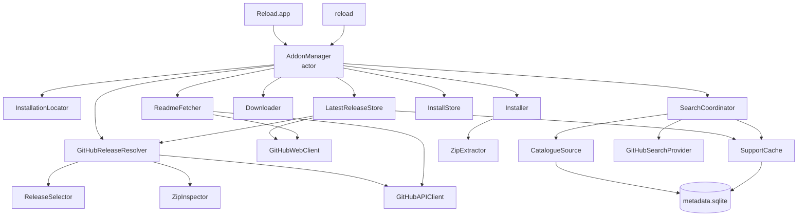

# Core library (AddonKit)

The `AddonKit` library, its `AddonManager` façade, how the components are layered, and where the code lives.

`AddonKit` does all the real work. The app and `reload` are thin front ends over it, and both go through one type: `AddonManager`. Why it's built this way: [decision 0001](../decisions/0001-swift-package-core.md).



Search never goes through `LatestReleaseStore`: it reads stored verdicts only ([search.md](../features/search.md)).

| Component | Doc |
|---|---|
| `LatestReleaseStore`, `GitHubReleaseResolver`, `ReleaseSelector`, `ZipInspector` | [release-selection.md](../features/release-selection.md) |
| `GitHubAPIClient`, `GitHubWebClient`, `ReadmeFetcher` | [github-endpoints.md](../network/github-endpoints.md), [caching.md](../network/caching.md) |
| `Downloader`, `Installer`, `ZipExtractor` | [installing.md](../features/installing.md) |
| `InstallStore`, `AppDirectories`, `MetadataDatabase` | [data-storage.md](data-storage.md) |
| `InstallationLocator` | [finding-wow.md](../features/finding-wow.md) |
| `SearchCoordinator`, `CatalogueSource`, providers | [search.md](../features/search.md) |
| Refresh, details | [refresh.md](../features/refresh.md), [details-and-screenshots.md](../features/details-and-screenshots.md) |
| `FlavorRules` and parsers | [flavors.md](flavors.md) |
| `AddonError` | [errors.md](errors.md) |

## Layering

- **All logic lives in `AddonKit`.** Anything the app can do, `reload` can do.
- **Pure code is separate from I/O.** TOC and `release.json` parsing, flavor detection and release selection are plain functions on value types, tested with fixture files.
- **I/O sits behind protocols** (`HTTPClient`, `DownloadTransport`, `SupportChecking`), so tests never touch the network.
- **Shared state lives in actors.** See [concurrency.md](concurrency.md).

## Source layout

```
Sources/AddonKit/
├── AddonManager*.swift      the façade (this doc), split by feature
├── AddonManaging.swift      the façade's protocol
├── Model/                   flavors, game families, refs, installs, releases, search models, errors
├── Parsing/                 TOC, release.json, .build.info (pure, no I/O)
├── Sources/                 Source/HTTPClient protocols
├── GitHub/                  LatestReleaseStore, GitHubReleaseResolver, API and web clients, ReadmeFetcher
├── Selection/               ReleaseSelector, ZipInspector, AdoptionIndex
├── Install/                 Downloader, ZipExtractor, Installer, InstallationLocator
├── Store/                   InstallStore, AppDirectories, MetadataDatabase
├── Search/                  catalogue, index, providers, SupportCache, SearchCoordinator
├── Details/                 ReadmeImages (screenshot URLs from a README)
└── Support/                 KeychainStore
Sources/reload/            the CLI (docs/cli/)
```

## Where things live

| Responsibility | File |
|---|---|
| The façade: init, dependencies, the token, test clocks | `Sources/AddonKit/AddonManager.swift` |
| Installations, the add-ons in one, `lookup` | `Sources/AddonKit/AddonManager+Installations.swift` |
| Search, Browse, stored flavors and catalogue rows | `Sources/AddonKit/AddonManager+Search.swift` |
| Resolve, install, adoption, uninstall, removing unmanaged folders | `Sources/AddonKit/AddonManager+Install.swift` |
| Update checks and states, updates, rollback, pin, channel | `Sources/AddonKit/AddonManager+Updates.swift` |
| GitHub status (quota, search quota, web pause), rate limit, clearing caches | `Sources/AddonKit/AddonManager+Maintenance.swift` |
| The façade's protocol, `MetadataChange`, `StoredAvailability` | `Sources/AddonKit/AddonManaging.swift` |
| Inspector details and their storage, release notes | `Sources/AddonKit/AddonManager+Details.swift` |
| Background refresh, its targets, progress, stored update states | `Sources/AddonKit/AddonManager+Refresh.swift` |
| Visible-row checks | `Sources/AddonKit/AddonManager+Visible.swift` |
| Observation API: metadata changes, store folder, stored availability | `Sources/AddonKit/AddonManager+Observation.swift` |
| Latest release, verdicts, available flavors, `CachePolicy`, quota-free resolve (the single cache owner) | `Sources/AddonKit/GitHub/LatestReleaseStore.swift` |
| Refs parsed, resolve over the releases API, the selection loop, zip inspection | `Sources/AddonKit/GitHub/GitHubReleaseResolver.swift` |
| REST API: token, ETags, persisted rate limit, quota reserve, release notes | `Sources/AddonKit/GitHub/GitHubAPIClient.swift` |
| github.com and raw requests: no-follow `HEAD`, global pause, jittered backoff, Low Data Mode | `Sources/AddonKit/GitHub/GitHubWebClient.swift` |
| README paths, ETag, "no README" cache, size cap | `Sources/AddonKit/GitHub/ReadmeFetcher.swift` |
| The GitHub pieces wired together | `Sources/AddonKit/GitHub/GitHub.swift` |
| GitHub API models (releases, assets) | `Sources/AddonKit/GitHub/GitHubModels.swift` |
| `Source` and `HTTPClient` protocols, the URL session, the User-Agent | `Sources/AddonKit/Sources/Source.swift` |
| Flavors, `FlavorRules`, interface ranges | `Sources/AddonKit/Model/Flavor.swift` |
| Game families, family filtering, availability sentence | `Sources/AddonKit/Model/GameFamily.swift` |
| Refs, installations, installed add-ons, releases, update states, operation events | `Sources/AddonKit/Model/Models.swift` |
| Catalogue entries, search queries and results, support status | `Sources/AddonKit/Model/SearchModels.swift` |
| Decisions front ends display: `InstallAction`, `UpdateOffer`, `BrowseFilter`, `AddonRef(parsing:)` | `Sources/AddonKit/Model/InstallAction.swift` |
| Unmanaged folders, TOC hints, adoption candidates and previews | `Sources/AddonKit/Model/Adoption.swift` |
| `AddonError` | `Sources/AddonKit/Model/AddonError.swift` |
| TOC, `release.json` and `.build.info` parsing | `Sources/AddonKit/Parsing/` |
| Release selection (pure) | `Sources/AddonKit/Selection/ReleaseSelector.swift` |
| Zip and folder flavor inspection | `Sources/AddonKit/Selection/ZipInspector.swift` |
| Adoption suggestions and folder grouping | `Sources/AddonKit/Selection/AdoptionIndex.swift` |
| Downloads and the download cache | `Sources/AddonKit/Install/Downloader.swift` |
| Zip validation and extraction | `Sources/AddonKit/Install/ZipExtractor.swift` |
| Install, uninstall, remove unmanaged folders | `Sources/AddonKit/Install/Installer.swift` |
| Finding WoW installations | `Sources/AddonKit/Install/InstallationLocator.swift` |
| Install store and its lock | `Sources/AddonKit/Store/InstallStore.swift` |
| App data directories | `Sources/AddonKit/Store/AppDirectories.swift` |
| Moving ForeverAddons-era data to Reload (decision 0024) | `Sources/AddonKit/Store/LegacyDataMigration.swift` |
| SQLite schema, migrations, change stream | `Sources/AddonKit/Store/MetadataDatabase.swift` |
| Catalogue download and storage | `Sources/AddonKit/Search/CatalogueSource.swift` |
| CSV reader | `Sources/AddonKit/Search/CSVParser.swift` |
| Stored verdicts, latest tags, available flavors, batched availability reads | `Sources/AddonKit/Search/SupportCache.swift` |
| Search layers merged, Browse content | `Sources/AddonKit/Search/SearchCoordinator.swift` |
| Text normalisation and the local index | `Sources/AddonKit/Search/SearchIndex.swift` |
| Query aliases and Browse categories | `Sources/AddonKit/Search/SearchAliases.swift` |
| Installed-add-on search layer | `Sources/AddonKit/Search/InstalledSearchProvider.swift` |
| Live GitHub search and its rate limit | `Sources/AddonKit/Search/GitHubSearchProvider.swift` |
| Screenshot URLs from a README | `Sources/AddonKit/Details/ReadmeImages.swift` |
| GitHub token in the Keychain | `Sources/AddonKit/Support/KeychainStore.swift` |
| CLI entry point and command list | `Sources/reload/ReloadCLI.swift` |
| CLI commands, one file per group | `Sources/reload/Commands/` |
| CLI options, context, installation choice | `Sources/reload/Context.swift`, `Sources/reload/Selection.swift` |
| CLI config and environment | `Sources/reload/Config.swift`, `Sources/reload/Environment.swift` |
| CLI output: tables, colour, JSON, errors and exit codes | `Sources/reload/Table.swift`, `Sources/reload/Terminal.swift`, `Sources/reload/JSONOutput.swift`, `Sources/reload/Errors.swift` |
| `addons.json` export format, read-only metadata views | `Sources/reload/AddonsFile.swift`, `Sources/reload/Metadata.swift` |

## AddonManager

`AddonManager` is an actor that implements `AddonManaging`. Create one with no arguments for real use. Every dependency can be injected for tests: directories, `HTTPClient`, download transport, locator, installer, Keychain and environment.

| Area | Methods |
|---|---|
| Installations | `installations()`, `detectInstallations()`, `addInstallation(at:)`, `removeInstallation(_:)` |
| Add-ons | `addons(in:)` (managed + unmanaged, reconciled with disk), `installedAddons(in:)`, `lookup(_:in:)` |
| Search | `search(_:in:)` and `search(_:in:installed:)` → `AsyncStream<[SearchResult]>`, `searchUpdates(_:in:installed:)` → `AsyncStream<SearchUpdate>`, `browse(in:)`, `catalogueEntry(for:)` |
| Install | `resolve(_:for:channel:)`, `resolve(_:for:channel:allowFamilyFallback:)`, `install(_:into:channel:force:allowFamilyFallback:progress:)` (the Retail build on Forever, [release-selection.md](../features/release-selection.md#retail-build-on-forever)) |
| Unmanaged folders | `adoptionCandidates(folder:in:)` (local), `adoptionPreview(for:folders:in:)`, `adopt(_:in:)`, `adopt(folder:as:in:)`, `removeUnmanaged(folders:from:)` ([installing.md](../features/installing.md#adopting-unmanaged-folders)) |
| Updates | `checkForUpdates(in:)`, `update(_:in:)` and `update(releases:in:)` → `AsyncStream<OperationEvent>` |
| Changes | `uninstall`, `rollback`, `setPinned`, `setChannel` |
| Metadata | `refresh(in:force:)` → `AsyncStream<RefreshProgress>`, `lastRefresh(in:)` ([refresh.md](../features/refresh.md)), `checkVisible(_:in:)` ([visible rows](../features/refresh.md#visible-row-checks)), `details(for:in:)` ([details](../features/details-and-screenshots.md)), `availableFlavors(for:)` (stored, local) |
| Misc | `tokenDidChange()`, `gitHubStatus()` ([quota status](../network/budget.md#quota-status)), `rateLimit()`, `clearCaches()`, `database.changes()` ([change stream](data-storage.md#change-stream)) |

### Behaviour worth knowing

- **Detection runs once.** `installations()` returns what's stored. Only the first call in a process with nothing stored runs Spotlight detection. After that, detection only runs when you call `detectInstallations()`.
- **Updates are detected by release, not version string.** An add-on is out of date when the chosen release has a different GitHub release ID *and* a later publish date (`InstalledAddon.isUpdate`). Version schemes are too inconsistent to compare (`v426.4`, `12.1.12`, `r1234-alpha`).
- **ETags are stored only while up to date.** That way a `304 Not Modified` always means "still current", never "an update you haven't installed".
- **Installs take the store lock.** See [installing.md](../features/installing.md).
- **Rollback** reinstalls `previousRelease` from the download cache (the last 2 zips per add-on) and **pins** the add-on so the next update doesn't undo it.
- **Update checks are mostly quota-free.** For the stable channel, the latest tag comes from github.com: an unchanged tag is up to date, and a new tag whose `release.json` has the flavor is the update, both without an API call. Only when neither decides, or for the prerelease channel, does the API resolve run (with the stored ETag). See [release-selection.md](../features/release-selection.md#quota-free-resolve-stable-channel).
- **Updating.** `update([])` checks every add-on as above and installs only available updates; pinned and up-to-date ones come back `.skipped`. `update(releases:in:)` installs releases the caller already resolved (the app's `.available(release)` states); an empty list does nothing. Up to 4 at once; one failure doesn't stop the others.
- **`lookup` order:** a GitHub ref or URL first, then an installed add-on's name, repo or folder, then an exact catalogue name. More than one result means the input was ambiguous.
- **GitHub token:** `RELOAD_GITHUB_TOKEN`, then `GITHUB_TOKEN`, then the Keychain (`KeychainStore`, service `io.github.miotke.Reload`, account `github-token`, shared by the app and CLI). It's read on the first API call, so launch never waits on a Keychain prompt. `tokenDidChange()` swaps it in place, keeping ETags, `release.json` files and the rate-limit state.
- **One URL session** for the core, with the app's User-Agent and no HTTP cache ([github-endpoints.md](../network/github-endpoints.md#headers)).
