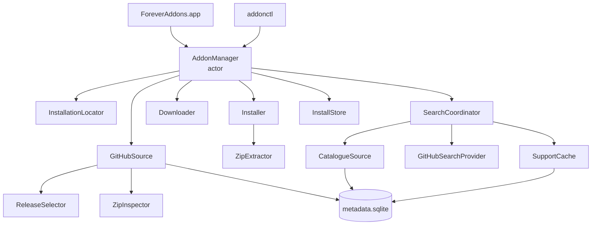

# Core library (AddonKit)

The `AddonKit` library, its `AddonManager` façade, how the components are layered, and where the code lives.

`AddonKit` does all the real work. The app and `addonctl` are thin front ends over it, and both go through one type: `AddonManager`. Why it's built this way: [decision 0001](../decisions/0001-swift-package-core.md).



Search no longer calls `GitHubSource`: it reads stored verdicts only ([search.md](../features/search.md)).

| Component | Doc |
|---|---|
| `GitHubSource`, `ReleaseSelector`, `ZipInspector` | [release-selection.md](../features/release-selection.md) |
| `Downloader`, `Installer`, `ZipExtractor` | [installing.md](../features/installing.md) |
| `InstallStore`, `AppDirectories`, `MetadataDatabase` | [data-storage.md](data-storage.md) |
| `InstallationLocator` | [finding-wow.md](../features/finding-wow.md) |
| `SearchCoordinator`, `CatalogueSource`, providers | [search.md](../features/search.md) |
| Refresh, details | [refresh.md](../features/refresh.md), [details-and-screenshots.md](../features/details-and-screenshots.md) |
| `FlavorRules` and parsers | [flavors.md](flavors.md) |
| `AddonError` | [errors.md](errors.md) |

## Layering

- **All logic lives in `AddonKit`.** Anything the app can do, `addonctl` can do.
- **Pure code is separate from I/O.** TOC and `release.json` parsing, flavor detection and release selection are plain functions on value types, tested with fixture files.
- **I/O sits behind protocols** (`HTTPClient`, `DownloadTransport`, `SupportChecking`), so tests never touch the network.
- **Shared state lives in actors.** See [concurrency.md](concurrency.md).

## Source layout

```
Sources/AddonKit/
├── AddonManager.swift       the façade (this doc)
├── AddonManager+Refresh.swift, AddonManager+Details.swift
├── AddonManaging.swift      the façade's protocol
├── Model/                   Flavor + FlavorRules, Installation, AddonRef, InstalledAddon,
│                            ResolvedRelease, search models, AddonError
├── Parsing/                 Toc, TocFileName, ReleaseJSON, BuildInfo (pure, no I/O)
├── Sources/                 Source/HTTPClient protocols, GitHubSource, GitHub API models
├── Selection/               ReleaseSelector, ZipInspector
├── Install/                 Downloader, ZipExtractor, Installer, InstallationLocator
├── Store/                   InstallStore, AppDirectories, MetadataDatabase
├── Search/                  catalogue, index, providers, SupportCache, SearchCoordinator
├── Details/                 ReadmeImages (screenshot URLs from a README)
└── Support/                 KeychainStore
```

## AddonManager

`AddonManager` is an actor that implements `AddonManaging`. Create one with no arguments for real use. Every dependency can be injected for tests: directories, `HTTPClient`, download transport, locator, installer, Keychain and environment.

| Area | Methods |
|---|---|
| Installations | `installations()`, `detectInstallations()`, `addInstallation(at:)`, `removeInstallation(_:)` |
| Add-ons | `addons(in:)` (managed + unmanaged, reconciled with disk), `installedAddons(in:)`, `lookup(_:in:)` |
| Search | `search(_:in:)` and `search(_:in:installed:)` → `AsyncStream<[SearchResult]>`, `searchUpdates(_:in:installed:)` → `AsyncStream<SearchUpdate>`, `browse(in:)`, `catalogueEntry(for:)` |
| Install | `resolve(_:for:channel:)`, `install(_:into:channel:force:progress:)` |
| Unmanaged folders | `adoptionCandidates(folder:in:)` (local), `adoptionPreview(for:folders:in:)`, `adopt(_:in:)`, `adopt(folder:as:in:)`, `removeUnmanaged(folders:from:)` ([installing.md](../features/installing.md#adopting-unmanaged-folders)) |
| Updates | `checkForUpdates(in:)`, `update(_:in:)` and `update(releases:in:)` → `AsyncStream<OperationEvent>` |
| Changes | `uninstall`, `rollback`, `setPinned`, `setChannel` |
| Metadata | `refresh(in:force:)` → `AsyncStream<RefreshProgress>`, `lastRefresh(in:)` ([refresh.md](../features/refresh.md)), `details(for:in:)` ([details](../features/details-and-screenshots.md)) |
| Misc | `tokenDidChange()`, `rateLimit()`, `clearCaches()`, `database.changes()` ([change stream](data-storage.md#change-stream)) |

### Behaviour worth knowing

- **Detection runs once.** `installations()` returns what's stored. Only the first call in a process with nothing stored runs Spotlight detection. After that, detection only runs when you call `detectInstallations()`.
- **Updates are detected by release, not version string.** An add-on is out of date when the chosen release has a different GitHub release ID *and* a later publish date (`InstalledAddon.isUpdate`). Version schemes are too inconsistent to compare (`v426.4`, `12.1.12`, `r1234-alpha`).
- **ETags are stored only while up to date.** That way a `304 Not Modified` always means "still current", never "an update you haven't installed".
- **Installs take the store lock.** See [installing.md](../features/installing.md).
- **Rollback.** Each install records the release it replaced in `previousRelease`. `rollback` reinstalls that release from the download cache, which keeps the last 2 zips per add-on, and **pins** the add-on so the next update doesn't undo it.
- **Update checks are mostly quota-free.** For the stable channel, the latest tag comes from github.com: an unchanged tag is up to date, and a new tag whose `release.json` has the flavor is the update, both without an API call. Only when neither decides, or for the prerelease channel, does the API resolve run (with the stored ETag). See [release-selection.md](../features/release-selection.md#quota-free-resolve-stable-channel).
- **Updating:**
  - `update([])` updates every add-on. Each one is checked as above first, and only installed if an update is available. Pinned and up-to-date add-ons come back as `.skipped`.
  - `update(releases:in:)` (on `AddonManaging`) installs releases the caller already resolved (the app's `.available(release)` states) without resolving again. An empty list does nothing.
  - Up to 4 add-ons are updated at once.
  - One failure doesn't stop the others.
- **`lookup` order:** a GitHub ref or URL first, then an installed add-on's name, repo or folder, then an exact catalogue name. More than one result means the input was ambiguous.
- **GitHub token:**
  - It comes from `ADDONS_GITHUB_TOKEN`, then `GITHUB_TOKEN`, then the Keychain (service `com.andrewmiotke.ForeverAddons`, account `github-token`).
  - `KeychainStore` lives in AddonKit so the app and the CLI share it.
  - It's read on the first GitHub call, not when `AddonManager` is created, so app launch never waits on a Keychain prompt.
  - Call `tokenDidChange()` after changing the Keychain item. It swaps the token in place; ETags, cached `release.json` files and the rate-limit state are kept.
- **One URL session** for the core: 20 s request timeout, no waiting for connectivity, no HTTP cache (ETags are explicit), User-Agent `ForeverAddons/<version> (+https://github.com/miotke/swift-addons)`. Background work (refresh) sets `allowsConstrainedNetworkAccess = false` per request, so it stays off Low Data Mode networks.
