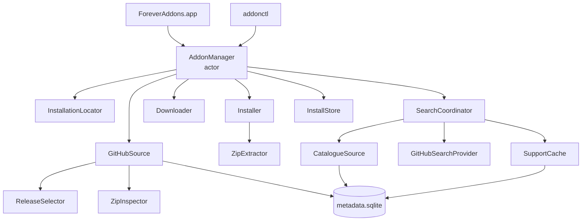

# Core library (AddonKit)

`AddonKit` is the Swift package library that does all the real work. The app and `addonctl` are thin front ends over it, and both go through one type: `AddonManager`.



| Component | Doc |
|---|---|
| Finding the right release on GitHub | [github-source.md](github-source.md) |
| Downloading, installing, storing, finding WoW | [installing.md](installing.md) |
| Search and Browse | [search.md](search.md) |

## Source layout

```
Sources/AddonKit/
├── AddonManager.swift       the façade (this doc)
├── AddonManaging.swift      the façade's protocol
├── Model/                   Flavor + FlavorRules, Installation, AddonRef, InstalledAddon,
│                            ResolvedRelease, search models, AddonError
├── Parsing/                 Toc, TocFileName, ReleaseJSON, BuildInfo (pure, no I/O)
├── Sources/                 Source/HTTPClient protocols, GitHubSource, GitHub API models
├── Selection/               ReleaseSelector, ZipInspector
├── Install/                 Downloader, ZipExtractor, Installer, InstallationLocator
├── Store/                   InstallStore, AppDirectories
├── Search/                  catalogue, index, providers, SupportCache, SearchCoordinator
└── Support/                 KeychainStore
```

## AddonManager

`AddonManager` is an actor that implements `AddonManaging`. Create one with no arguments for real use. Every dependency can be injected for tests: directories, `HTTPClient`, download transport, locator, installer, Keychain and environment.

| Area | Methods |
|---|---|
| Installations | `installations()`, `detectInstallations()`, `addInstallation(at:)`, `removeInstallation(_:)` |
| Add-ons | `addons(in:)` (managed + unmanaged, reconciled with disk), `installedAddons(in:)`, `lookup(_:in:)` |
| Search | `search(_:in:)` and `search(_:in:installed:)` → `AsyncStream<[SearchResult]>`, `searchUpdates(_:in:installed:)` → `AsyncStream<SearchUpdate>`, `browse(in:)`, `catalogueEntry(for:)` |
| Install | `resolve(_:for:channel:)`, `install(_:into:channel:force:progress:)`, `adopt(folder:as:in:)` |
| Updates | `checkForUpdates(in:)`, `update(_:in:)` → `AsyncStream<OperationEvent>` |
| Changes | `uninstall`, `rollback`, `setPinned`, `setChannel` |
| Metadata | `refresh(in:force:)` → `AsyncStream<RefreshProgress>`, `lastRefresh(in:)`, `details(for:in:)` ([search.md](search.md#refresh)) |
| Misc | `tokenDidChange()`, `rateLimit()`, `clearCaches()`, `database.changes()` |

### Behaviour worth knowing

- **Detection runs once.** `installations()` returns what's stored. Only the first call in a process with nothing stored runs Spotlight detection. After that, detection only runs when you call `detectInstallations()`.
- **Updates are detected by release, not version string.** An add-on is out of date when the chosen release has a different GitHub release ID *and* a later publish date (`InstalledAddon.isUpdate`).
- **ETags are stored only while up to date.** That way a `304 Not Modified` always means "still current", never "an update you haven't installed".
- **Installs take the store lock.** The download happens first. The ownership check, the folder swap and the store write then run as one step under the cross-process store lock, so the app and the CLI can't interleave.
- **Rollback.** Each install records the release it replaced in `previousRelease`. `rollback` reinstalls that release from the download cache, which keeps the last 2 zips per add-on, and **pins** the add-on so the next update doesn't undo it.
- **Update checks are mostly quota-free.** For the stable channel, the latest tag comes from github.com: an unchanged tag is up to date, and a new tag whose `release.json` has the flavor is the update (both without an API call). Only when neither decides, or for the prerelease channel, does the API resolve run (with the stored ETag).
- **Updating:**
  - `update([])` updates every add-on. Each one is checked as above first, and only installed if an update is available. Pinned and up-to-date add-ons come back as `.skipped`.
  - `update(releases:in:)` installs releases the caller already resolved (the app's `.available(release)` states) without resolving again.
  - Up to 4 add-ons are updated at once.
  - One failure doesn't stop the others.
- **`lookup` order:** a GitHub ref or URL first, then an installed add-on's name, repo or folder, then an exact catalogue name. More than one result means the input was ambiguous.
- **GitHub token:**
  - It comes from `ADDONS_GITHUB_TOKEN`, then `GITHUB_TOKEN`, then the Keychain (service `com.andrewmiotke.ForeverAddons`, account `github-token`).
  - It's read on the first GitHub call, not when `AddonManager` is created, so app launch never waits on a Keychain prompt.
  - Call `tokenDidChange()` after changing the Keychain item. It swaps the token in place; ETags, cached `release.json` files and the rate-limit state are kept.
- **One URL session** for the core: 20 s request timeout, no waiting for connectivity, no HTTP cache (ETags are explicit), User-Agent `ForeverAddons/<version> (+https://github.com/miotke/swift-addons)`. Background work (refresh) sets `allowsConstrainedNetworkAccess = false` per request, so it stays off Low Data Mode networks.

## Flavors

All game-version-specific constants live in one table, `FlavorRules` (`Model/Flavor.swift`). When Forever launches with a final folder name, that table is the only thing that changes.

| | Forever |
|---|---|
| Interface range | 16000–19999 |
| Game versions | 1.60.0–1.99.99 |
| TOC suffixes | `Camelot`, `Forever` (after `_` or `-`); `Mainline` counts if its interface is in range |
| `release.json` flavor | `forever` |
| Known folders | `_classic_beta_` → `wow_classic_beta` |

`mainline` and `classic` exist in the enum so the model never assumes a single game version, but only Forever is managed today.

## Parsers

All parsers are pure functions, and their tests use fixture files.

- **`Toc`** reads `## Key: Value` headers. It handles a byte-order mark, CRLF line endings, case-insensitive keys, comma-separated `Interface` lists, and WoW colour and texture codes in titles.
- **`TocFileName`** splits `BigWigs_Camelot.toc` into the add-on name and the suffix.
- **`ReleaseJSON`** decodes the BigWigs packager format. `release(for:)` picks the first full (non-`nolib`) build for a flavor.
- **`BuildInfo`** parses Blizzard's pipe-separated `.build.info` file.

## Errors

Everything throws `AddonError`, which has user-facing `errorDescription`s:
- `notFound`
- `noCompatibleRelease`
- `rateLimited(resetAt:)`
- `folderConflict`
- `unmanagedFolderExists`, meaning retry with `force`
- `noRollbackAvailable`
- and others.

## Metadata database

Everything AddonKit knows about add-ons it hasn't installed lives in one SQLite file, `<applicationSupport>/metadata.sqlite`: the catalogue, support verdicts, repo metadata, inspector details, refresh state and rate limits. The schema is in [search.md](search.md#metadata-database). Installed add-on records stay in the `InstallStore` JSON files.

`MetadataDatabase` is a small actor over the system SQLite (`import SQLite3`, no packages):
- It owns the connection, opened without SQLite's mutex, since the actor already serializes access.
- **Shared with the CLI:** WAL mode, a 5 s busy timeout, `foreign_keys=ON`.
- Prepared statements are cached by SQL text. Arguments bind as `Int`/`Int64`, `Double`, `String`, `Data`, `Bool`, `Date` (Unix seconds) or nil. Text and blobs are copied (`SQLITE_TRANSIENT`).
- `transaction { }` uses `BEGIN IMMEDIATE`. Its body is synchronous, so a write lock is never held across a network wait.
- Failures throw `SQLiteError` with SQLite's message.
- **Migrations:** an ordered list of SQL scripts. `PRAGMA user_version` records how many have run. Each new one runs in its own transaction when the database opens, and shipped steps are never edited.

## Concurrency

- Swift 6 language mode with strict concurrency, plus `NonisolatedNonsendingByDefault` and `InferIsolatedConformances`.
- Shared state lives in actors (`AddonManager`, `InstallStore`, `Downloader`, `GitHubSource`, the search actors), or in `Mutex` for small pieces.
- There's no `@unchecked Sendable` in library code.
