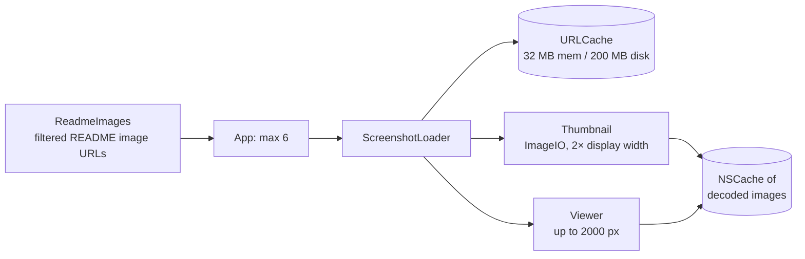

# Details and screenshots

What the inspector and the add-on window show for an add-on, how details are loaded, and how README and screenshot images are rendered.

Code: `AddonManager+Details.swift` (`details(for:in:)` → `AddonDetails`), `Details/ReadmeImages.swift`; app side in `App/ForeverAddons/Views/AddonInspectorView.swift`, `ScreenshotViews.swift`, `MarkdownView.swift`, `Support/ScreenshotLoader.swift`, `Support/MarkdownBlocks.swift`. Where the inspector sits: [app/layout.md](../app/layout.md).

## What the inspector shows

The same view (`AddonDetailView`) fills the inspector and, in a `.window` style, the [add-on window](../app/layout.md#add-on-window).

For any selected add-on, installed or not:

| Part | Contents |
|---|---|
| Header | Name, author, summary, support badge for the installation's flavor |
| Actions | Install / Update / Roll Back / Uninstall |
| Details | Latest version and date, stars, last update, license, topics, GitHub and homepage links |
| Screenshots | A strip of README images |
| README | Rendered Markdown |
| Installed only | Installed version, dates, channel, pin, folders, changelog |

## Where the fields come from

Opening an add-on is one of the times the core goes to the network.

| Field | Source |
|---|---|
| name, owner, summary, last updated | the `catalogue` row (also for repos found by live search), else the installed record or repo name |
| stars | `repo_meta`, from live search results |
| support, latest version | the stored verdict, via `check(policy: .revalidateIfStale)` (quota-free) |
| README | raw.githubusercontent.com, see [README](#readme) |
| screenshots | images in the README, see [Screenshots](#screenshots) |
| latest release date and notes | the API resolve, only while quota is comfortable; otherwise the last stored ones |

- The result is stored in the `details` table and reused for 24 h. If the README couldn't be fetched, nothing is stored, so a network blip isn't kept for a day.
- Cost: 2–4 quota-free requests for that repo, only when stale ([budget.md](../network/budget.md)).

## Loading details in the app

- Details load **250 ms after the selection settles**, so arrow-keying through a table doesn't fetch every row.
- They're **cancelled when the selection changes**.
- Results are cached per add-on for the session. Failures show inline with **Try Again**.
- The returned support status updates that row's badge in the tables.

## README

**Fetching (core):**
- Fetched from `raw.githubusercontent.com/{owner}/{repo}/HEAD/<path>`: `HEAD` there means the default branch, which the catalogue doesn't give.
- The paths GitHub itself uses are tried in order: `README.md`, `.github/README.md`, `readme.md`, `Readme.md`, `docs/README.md`, `README.markdown`, `README.MD`, `README`.
- The path that worked and its ETag are kept in `repo_meta`, so the next check is one conditional request. "No README" is remembered too.
- READMEs are capped at 512 KB. The API's `/readme` is asked only with a token, when every path 404s.

**Rendering (app):**
- Parsed **off the main actor** by `MarkdownParser`: headings, paragraphs, lists, code, quotes, tables and rules. Images, HTML tags and comments are stripped.
- Rendered lazily by `MarkdownView`, with relative links resolved against the repository.
- Parsed results are cached. Changelogs use the same renderer.
- Cost: 19 ms for a 32 KB README ([measurements](../performance/measurements.md)), which is why it can't run on the main actor.

## Screenshots

Why it works this way: [decision 0013](../decisions/0013-screenshot-loading.md).

- **Which images (core, `ReadmeImages`):** Markdown inline and reference images and HTML ``, in document order and de-duplicated, ignoring code blocks and comments. Relative paths resolve against the README's folder on raw.githubusercontent.com; `github.com/…/blob/…` and `…/raw/…` links become raw URLs. Badges (shields.io and similar hosts, CI status images, anything with "badge" in the path), SVGs, favicons, `NNxNN` icons and images an `` sizes at 64 px or less are dropped.
- **Filtering belongs to the core.** The app only caps the list at 6 images per add-on and refuses images over 5 MB.
- **Download once:** `ScreenshotLoader` has its own `URLSession` with a dedicated `URLCache` (32 MB memory, 200 MB disk). Images over 5 MB are refused.
- **Thumbnail decode:** ImageIO downsamples to twice the thumbnail width (for Retina) off the main actor. Thumbnails are 150×96 in the inspector and 320×200 in the add-on window. They load lazily as the strip scrolls.
- **Full resolution only in the viewer:** clicking a thumbnail opens a sheet (← / → to step, Esc to close) that decodes a larger version (up to 2000 px).
- Decoded images are kept in an `NSCache`, keyed by size and URL.
- Loads are cancelled when the selection changes.
