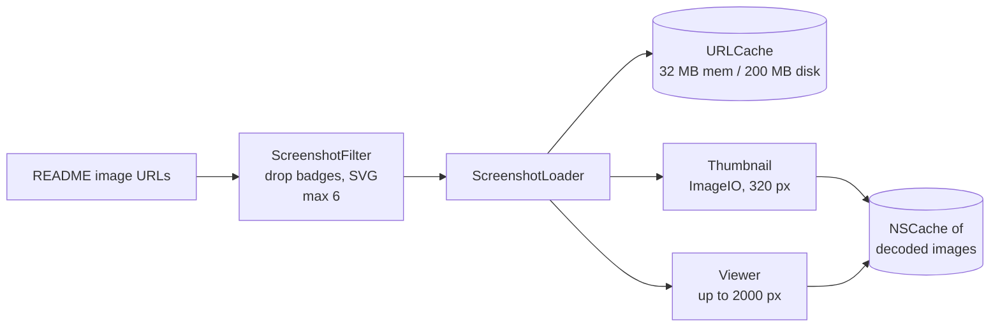

# Details and screenshots

What the inspector shows for a selected add-on, how details are loaded, and how README and screenshot images are rendered.

Code: `AddonManager.details(for:in:)` → `AddonDetails`; app side in `App/ForeverAddons/Views/AddonInspectorView.swift`, `ScreenshotViews.swift`, `MarkdownView.swift`, `Support/ScreenshotLoader.swift`, `Support/MarkdownBlocks.swift`. Where the inspector sits: [app/layout.md](../app/layout.md).

> `details(for:in:)` is a placeholder on this branch (name, owner and repo URL only). The real version, which reads the metadata database and refreshes a stale repo, lands with the core merge.

## What the inspector shows

For any selected add-on, installed or not:

| Part | Contents |
|---|---|
| Header | Name, author, summary, Forever badge |
| Actions | Install / Update / Roll Back / Uninstall |
| Details | Latest version and date, stars, last update, license, topics, GitHub and homepage links |
| Screenshots | A strip of README images |
| README | Rendered Markdown |
| Installed only | Installed version, dates, channel, pin, folders, changelog |

## Loading details

- Details load **250 ms after the selection settles**, so arrow-keying through a table doesn't fetch every row.
- They're **cancelled when the selection changes**.
- Results are cached per add-on for the session. Failures show inline with **Try Again**.
- The returned support status updates that row's badge in the tables.
- Network cost after the core merge: 2–4 quota-free requests for that repo, only if it's stale ([budget.md](../network/budget.md)).

## README

- Parsed **off the main actor** by `MarkdownParser`: headings, paragraphs, lists, code, quotes, tables and rules. Images, HTML tags and comments are stripped.
- Rendered lazily by `MarkdownView`, with relative links resolved against the repository.
- Parsed results are cached. Changelogs use the same renderer.
- Cost: 19 ms for a 32 KB README ([measurements](../performance/measurements.md)), which is why it can't run on the main actor.

## Screenshots

Why it works this way: [decision 0013](../decisions/0013-screenshot-loading.md).

- **Which images:** README images minus badges (shields.io, badgen, CI badges, `…/badge.svg`) and SVGs, at most 6 per add-on.
- **Download once:** `ScreenshotLoader` has its own `URLSession` with a dedicated `URLCache` (32 MB memory, 200 MB disk). Images over 5 MB are refused.
- **Thumbnail decode:** ImageIO downsamples to the display size (320 px on the long side) off the main actor. Thumbnails load lazily as the strip scrolls.
- **Full resolution only in the viewer:** clicking a thumbnail opens a sheet (← / → to step, Esc to close) that decodes a larger version (up to 2000 px).
- Decoded images are kept in an `NSCache`, keyed by size and URL.
- Loads are cancelled when the selection changes.
