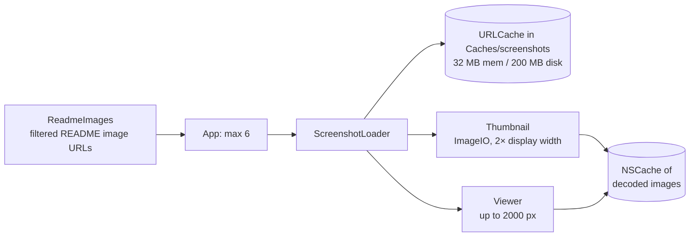

# Details and screenshots

What the inspector and the add-on window show for an add-on, how details are loaded, and how README and screenshot images are rendered.

Code: `AddonManager+Details.swift` (`details(for:in:)` → `AddonDetails`), `GitHub/ReadmeFetcher.swift`, `Details/ReadmeImages.swift`; app side in `App/Reload/Views/AddonInspectorView.swift`, `ScreenshotViews.swift`, `MarkdownView.swift`, `Support/ScreenshotLoader.swift`, `Support/MarkdownBlocks.swift`. Where the inspector sits: [app/layout.md](../app/layout.md).

## What the inspector shows

The same view (`AddonDetailView`) fills the inspector and, in a `.window` style, the [add-on window](../app/layout.md#add-on-window).

For any selected add-on, installed or not:

| Part | Contents |
|---|---|
| Header | Name, author, summary, the [Games bubbles](../app/layout.md#games) and a sentence on what they mean for the installation |
| Actions | Install (**Install Retail Build…** for a Retail-only add-on on Forever), or "Installed v…" with Update / Roll Back / Uninstall, from the managed list ([layout.md](../app/layout.md#installed-state)) |
| Details | Latest version and date, stars, last update, license, topics, GitHub and homepage links |
| Screenshots | A strip of README images |
| README | Rendered Markdown |
| Installed only | Installed version, dates, channel, pin, folders, changelog |

Unmanaged folders get their own inspector, which shows the suggested repo's summary, screenshots and README through the same `details(for:in:)` ([layout.md](../app/layout.md#unmanaged-folders-inspector-and-adopt-sheet)).

## Where the fields come from

Opening an add-on is one of the times the core goes to the network.

| Field | Source |
|---|---|
| name, owner, summary, last updated | the `catalogue` row (also for repos found by live search), else the installed record or repo name |
| stars | `repo_meta`, from live search results |
| support, latest version | `latestRelease`: `.revalidateIfStale` when the details are stale, the stored verdict otherwise (quota-free) |
| README | raw.githubusercontent.com, see [README](#readme) |
| screenshots | images in the README, see [Screenshots](#screenshots) |
| latest release notes and date | on demand, see [Release notes](#release-notes); shown when stored for the current latest tag |

- The result is stored in the `details` table and reused for 24 h. If the README couldn't be fetched, nothing is stored, so a network blip isn't kept for a day.
- Cost: **no API calls and no zip downloads**. A cold open is a `HEAD` for the latest tag, that tag's `release.json` (once per tag, [caching.md](../network/caching.md#lifetimes)) and the README paths; fresh details cost nothing ([budget.md](../network/budget.md)).

## Release notes

- `AddonManager.releaseNotes(for:in:)` → `(version, publishedAt, markdown)?`, nil when the repo has no releases.
- Stored notes for the current latest tag are returned without a request. Otherwise it's **one API call** (`releases/latest`; none if this process already holds the release list), never a zip, and the answer is stored in `details` by tag.
- The inspector and the add-on window show **Show Release Notes** where notes aren't stored. With a token and comfortable quota, `details` loads them automatically.
- A new latest tag hides the old notes until they're asked for again. Installed add-ons also show the changelog stored with the install.

## Loading details in the app

- Details load **250 ms after the selection settles**, so arrow-keying through a table doesn't fetch every row.
- They're **cancelled when the selection changes**.
- Results are cached for the 20 most recently viewed add-ons in the session. Failures show inline with **Try Again**.
- The returned support status and available flavors update that row's games in the tables.

## README

**Fetching (core):**
- Fetched from `raw.githubusercontent.com/{owner}/{repo}/HEAD/<path>`: `HEAD` there means the default branch, which the catalogue doesn't give.
- The paths GitHub itself uses are tried in order: `README.md`, `.github/README.md`, `readme.md`, `Readme.md`, `docs/README.md`, `README.markdown`, `README.MD`, `README`.
- `ReadmeFetcher` keeps the path that worked and its ETag in `repo_meta`, so the next check is one conditional request. "No README" is remembered too, and trusted for 7 days before the paths are tried again.
- READMEs are capped at 512 KB. The API's `/readme` is asked only with a token, when every path 404s.

**Rendering (app):**
- Parsed **off the main actor** by `MarkdownParser`: headings, paragraphs, lists, code, quotes, tables and rules. Images, HTML tags and comments are stripped. Each block's inline Markdown is rendered to an `AttributedString` in the same pass (`renderedBlocks`), so `MarkdownView` parses nothing on the main actor.
- Rendered lazily by `MarkdownView`; relative links were resolved against the repository while parsing.
- Parsed results are cached. Changelogs use the same renderer.
- Cost: 19 ms for a 32 KB README ([measurements](../performance/measurements.md)), which is why it can't run on the main actor.

## Screenshots

Why it works this way: [decision 0013](../decisions/0013-screenshot-loading.md).

- **Which images (core, `ReadmeImages`):** Markdown inline and reference images and HTML ``, in document order and de-duplicated, ignoring code blocks and comments. Relative paths resolve against the README's folder on raw.githubusercontent.com; `github.com/…/blob/…` and `…/raw/…` links become raw URLs. Badges (shields.io and similar hosts, CI status images, anything with "badge" in the path), SVGs, favicons, `NNxNN` icons and images an `` sizes at 64 px or less are dropped.
- **Filtering belongs to the core.** The app only caps the list at 6 images per add-on and refuses images over 5 MB.
- **Download once:** `ScreenshotLoader` keeps a dedicated `URLCache` (32 MB memory, 200 MB disk) in `<caches>/screenshots/` (`AppDirectories.screenshotsDirectory`), so `RELOAD_DATA_DIR` moves it and clearing caches (`clearCaches()`, `reload cache clear`) empties it. The loader reads it before the network and stores each image itself, so a server's cache headers can't keep it out. A test checks a relaunch reads the disk copy.
- **Capped while streaming:** a `Content-Length` over 5 MB is refused before the body; without one, the body arrives in the session's chunks (a data delegate, not `AsyncBytes` byte by byte, which cost about 62 ms of CPU per MB) and is cancelled once it passes 5 MB. Non-2xx responses, non-images and SVGs are refused too.
- **Thumbnail decode:** ImageIO downsamples to twice the thumbnail width (for Retina) off the main actor and off the loader's actor, at most 3 at a time, so a gallery's thumbnails decode in parallel. Thumbnails are 150×96 in the inspector and 320×200 in the add-on window. They load lazily as the strip scrolls.
- **Full resolution only in the viewer:** clicking a thumbnail opens a sheet (← / → to step, Esc to close) that decodes a larger version (up to 2000 px).
- Decoded images are kept in an `NSCache`, keyed by size and URL.
- Loads are cancelled when the selection changes.
