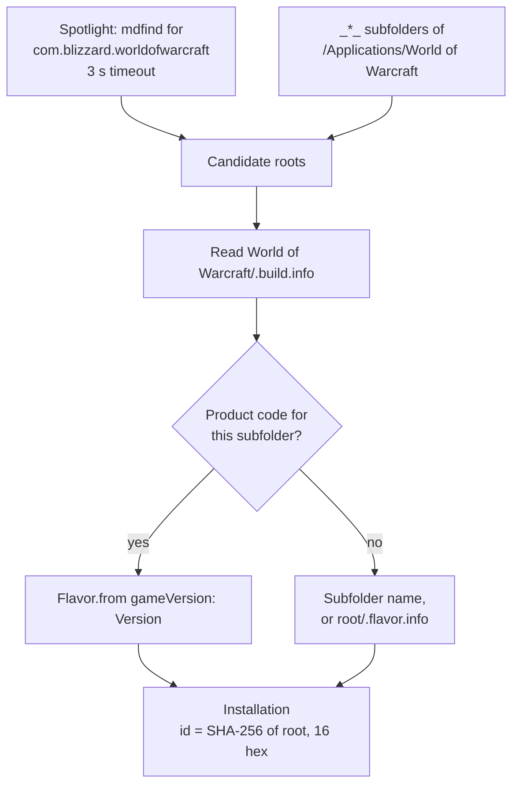

# Finding WoW

How `InstallationLocator` finds World of Warcraft installs, works out which game version each folder is, and gives each one an ID.

Code: `Sources/AddonKit/Install/InstallationLocator.swift`, `Sources/AddonKit/Parsing/BuildInfo.swift`.

## Steps

1. **Candidates:**
   - Spotlight: `mdfind "kMDItemCFBundleIdentifier == 'com.blizzard.worldofwarcraft'"`, with a 3-second timeout. The WoW `.app` sits inside the game-version folder, so its parent is the installation root.
   - Plus `_*_` subfolders of `/Applications/World of Warcraft`.
2. **Game version:** read `World of Warcraft/.build.info`, look up the product code for the subfolder, and map its `Version` with `Flavor.from(gameVersion:)` ([flavors.md](../architecture/flavors.md)). Fall back to the subfolder name, or to `<root>/.flavor.info`.
3. **ID:** the first 16 hex characters of the SHA-256 of the resolved root path.

Detection only reads. It never writes anything into the game folder.

## Adding a folder by hand

`installation(at:)` (behind `AddonManager.addInstallation(at:)`, **Add Installation…** in the app and `addonctl installs add`) accepts any of these:
- the game-version folder itself, e.g. `World of Warcraft/_classic_beta_`
- its `Interface/AddOns` folder
- the `World of Warcraft` folder, when it holds exactly one game-version folder

Anything else throws `installationNotFound`.

## When detection runs

- `installations()` returns what's stored. Only the first call in a process with nothing stored runs detection.
- After that, only `detectInstallations()` runs it (`addonctl installs` does).
- With `ADDONS_DATA_DIR` set, auto-detection is off, so only folders you add exist ([development.md](../development.md#testing-without-touching-your-real-setup)).

## Forever today

| | Value |
|---|---|
| Install folder (beta) | `World of Warcraft/_classic_beta_/Interface/AddOns/` |
| Product code | `wow_classic_beta` |
| Game version example | `1.60.1.70338` |

The folder and product code may change when Forever launches. Detection maps by game version first, so it keeps working; update [FlavorRules](../architecture/flavors.md) when it does.
