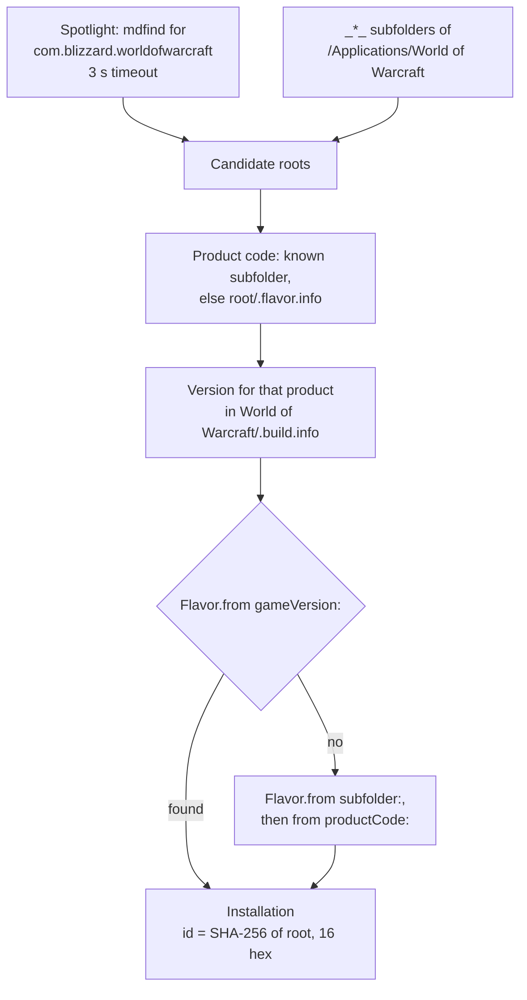

# Finding WoW

How `InstallationLocator` finds World of Warcraft installs, works out which game version each folder is, and gives each one an ID.

Code: `Sources/AddonKit/Install/InstallationLocator.swift`, `Sources/AddonKit/Parsing/BuildInfo.swift`.

## Steps

1. **Candidates:**
   - Spotlight: `mdfind "kMDItemCFBundleIdentifier == 'com.blizzard.worldofwarcraft'"`, with a 3-second timeout. The WoW `.app` sits inside the game-version folder, so its parent is the installation root.
   - Plus `_*_` subfolders of `/Applications/World of Warcraft`.
2. **Product code:** from the subfolder's entry in the flavors' `knownSubfolders`, else from `<root>/.flavor.info`.
3. **Flavor:** the **`.build.info` version decides first**: the product's `Version` mapped with `Flavor.from(gameVersion:)`. Ranges are disjoint, so there's one answer ([flavors.md](../architecture/flavors.md)). Fallbacks: `Flavor.from(subfolder:)`, then `Flavor.from(productCode:)`. No match throws `installationNotFound`.
4. **ID:** the first 16 hex characters of the SHA-256 of the resolved root path.

Detection only reads. It never writes anything into the game folder.

## Adding a folder by hand

`installation(at:)` (behind `AddonManager.addInstallation(at:)`, **Add Installation…** in the app and `addonctl installs add`) accepts any of these:
- the game-version folder itself, e.g. `World of Warcraft/_classic_beta_`
- its `Interface/AddOns` folder
- the `World of Warcraft` folder, when it holds exactly one game-version folder

Anything else throws `installationNotFound`.

## When detection runs

- `installations()` returns what's stored. Only the first call in a process with nothing stored runs detection.
- After that, only `detectInstallations()` runs it (`addonctl installs` does).
- With `ADDONS_DATA_DIR` set, auto-detection is off, so only folders you add exist ([development.md](../development.md#testing-without-touching-your-real-setup)).

## Known folders

| Folder | Product | Flavor |
|---|---|---|
| `_retail_` | `wow` | Retail (`mainline`) |
| `_ptr_` | `wowt` | Retail |
| `_beta_` | `wow_beta` | Retail |
| `_classic_beta_` | `wow_classic_beta` | Forever (beta) |
| `_classic_era_` | `wow_classic_era` | Classic Era (`vanilla`) |
| `_anniversary_` | `wow_anniversary` | TBC Anniversary (`tbc`) |
| `_classic_` | `wow_classic` | Mists Classic (`mists`) today |

Folder names only seed the product code. `_classic_` has held different games over time, which is why the version decides. Forever's folder and product may change at launch; update its [FlavorRules](../architecture/flavors.md) entry when they do.

## Saved installations from older versions

Stores written before the classic split saved `"flavor":"classic"`. They still load: `Installation` decoding recovers the flavor from the saved game version, then the product code, then the root's folder name. Only if none match does decoding fail.
