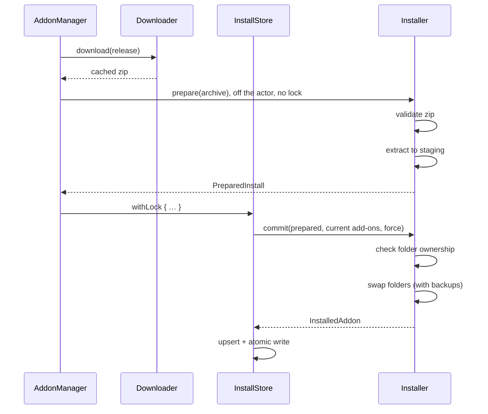

# Installing

How an add-on gets from a download onto disk: the install, update, rollback and uninstall flow, the safety checks, and the `Downloader`.

Code: `Sources/AddonKit/Install/` (`Downloader`, `ZipExtractor`, `Installer`); the flows in `AddonManager+Install.swift` and `AddonManager+Updates.swift`. Records are kept by the `InstallStore` ([data-storage.md](../architecture/data-storage.md)). Why it works like a transaction: [decision 0004](../decisions/0004-transactional-installer.md).

## Install flow

The download comes first, then `Installer.prepare` validates the zip and extracts it into staging (about 106 ms for 8 MB) **before** the store lock is taken. Only `commit` (the ownership check and the folder swap) and the store write run under the cross-process store lock, so the app and the CLI can't interleave, and neither waits on the other's extraction. If the ownership check fails after extraction, the staging folder is deleted; if the lock or the store read fails before `commit` runs, `PreparedInstall.discard()` deletes it.

### 1. Validate (`ZipExtractor`)

Nothing touches disk until the whole archive passes these checks:
- Every entry must stay inside the destination. `..`, absolute paths, `C:` paths and symlink entries are rejected (`unsafeArchivePath`); this blocks "zip-slip" attacks.
- `__MACOSX/`, `.DS_Store` and loose top-level files (READMEs, `BUILD_INFO.txt`) are skipped, not extracted. WoW ignores files in AddOns, so they're no reason to fail.
- There must be at least one top-level folder containing a `.toc`. Otherwise the archive is `invalidArchive`.
- It may unpack to at most 1 GB and 50,000 entries (`ZipExtractor.maxUncompressedBytes`, `maxEntries`), so a small "zip bomb" can't fill the disk. Downloads themselves stop past 200 MB (`URLSessionDownloadTransport.defaultMaxBytes`).
- `Blizzard_*` folders are rejected.

### 2. Ownership (`Installer`)

For each top-level folder in the zip:

| On disk | Result |
|---|---|
| Owned by this add-on | Replaced |
| Owned by another managed add-on | `folderConflict(folder, owner)` |
| Exists but no add-on manages it | `unmanagedFolderExists` unless `force` (app: **Overwrite**; CLI: `--force`) |
| Doesn't exist | Created |

Folder names are compared case-insensitively.

### 3. Staging and swap

1. Extract into a staging folder on the same volume, so the moves are instant renames (`prepare`, before the lock).
2. For each folder, move the old copy to a backup folder, then move the new copy in.
3. Folders the previous version owned but the new one doesn't ship are moved out too.
4. **If any step fails, the backups are restored in reverse order.** If restoring itself fails, the staging folder is kept so nothing is lost.

## Update, rollback, uninstall, adopt

| Operation | What happens |
|---|---|
| Update | Check first, quota-free on the stable channel ([release-selection.md](release-selection.md#quota-free-resolve-stable-channel)); install only if an update is available. `update(releases:in:)` installs already-resolved releases without re-resolving. Up to 4 at once; pinned add-ons are skipped |
| Rollback | Reinstall `previousRelease` from the download cache, then pin. Fails with `noRollbackAvailable` if the zip is gone |
| Uninstall | Move the add-on's folders to the Trash (`FileManager.trashItem`), then remove the record. Folders already missing aren't an error |
| Adopt | Resolve the chosen repo and install over the unmanaged folders its zip ships, after confirmation ([below](#adopting-unmanaged-folders)) |
| Remove unmanaged | Move unmanaged folders to the Trash after confirmation ([below](#removing-unmanaged-folders)) |

If WoW is running, the CLI says to `/reload` after changes ([cli/output.md](../cli/output.md)). Installs aren't blocked.

## Adopting unmanaged folders

How an unmanaged folder's TOC is read and grouped: [data-storage.md](../architecture/data-storage.md#reconcile). Why suggestions work this way: [decision 0018](../decisions/0018-adoption-suggestions-from-toc-hints.md).

1. **Suggest** (`adoptionCandidates(folder:in:)`, local only). Hints from all of the folder's TOCs are matched in this order, each repo listed once with its strongest reason:

   | Source | Reason shown | Confidence |
   |---|---|---|
   | `X-Website` / `X-Github` on github.com | "TOC links to github.com/owner/repo" | high |
   | `X-Curse-Project-ID` = catalogue `curse_id` | "Matched CurseForge project 334372" | high |
   | `X-Wago-ID` = `wago_id` | "Matched Wago project qv634BKb" | high |
   | `X-WoWI-ID` = `wowi_id` | "Matched WoWInterface project …" | high |
   | catalogue name = folder or TOC title (no case) | "Matched folder name" / "Matched TOC title …" | medium |
   | repository name = folder or title | "Matched repository name" | low |

   Ties within a source are ordered by catalogue `last_updated`, newest first. Up to 5 candidates; when more than one shares the best confidence (`isAmbiguous`), the user picks.
2. **Preview** (`adoptionPreview(for:folders:in:)`). Resolves the repo's stable release for the flavor the normal way (quota-free for `release.json` add-ons), downloads its zip into the cache the install reuses, and lists the top-level folders it `replaces`, `adds`, those another managed add-on owns (`conflicts`), and the asked-about folders it doesn't ship (`notCovered`). It records `release_folders`, so the Installed list groups those folders from then on. No build for the flavor throws `noCompatibleRelease`.
3. **Adopt** (`adopt(_ release:in:)`, or `adopt(folder:as:in:)`, which resolves first). Installs with `force`, so every unmanaged folder the zip ships is replaced in one transaction.

The Questie case: `Questie/` has `Questie.toc` (interface `00000`, "game client not supported"), `Questie_Camelot.toc` (16001, "Questie v12.0.4", CurseForge 334372, Wago qv634BKb) and classic TOCs. Forever reads `Questie_Camelot.toc`, so the row says "Questie", `v12.0.4`, and suggests `Questie/Questie` ("Matched CurseForge project 334372"). `QuestieDB/` has no hints: it stays a separate row until a downloaded Questie release is seen to ship it.

## Removing unmanaged folders

`removeUnmanaged(folders:from:)` moves folders to the Trash with the installer's trash handler, under the store lock. It checks **every** name before moving any, and refuses with `cannotRemove(folder:reason:)`:
- `Blizzard_*` folders
- folders a managed add-on owns (uninstall that instead)
- anything that isn't a single folder directly in `AddOns/` (`..`, paths, files)
- folders that don't exist

Names compare case-insensitively and duplicates are removed once, so a whole group can be passed at once. The app asks first (listing the folders); the CLI is `reload remove --unmanaged <folder…>`.

## Downloader

- Downloads with `URLSession` and reports progress from 0 to 1.
- Reuses a cached zip when one exists. Concurrent requests for the same release share one download.
- Zips inspected during a resolve are stored at the same paths, so the install reuses them.
- **Checks the host's checksum** when the release has one (`ResolvedRelease.md5`, from WoWInterface's `UIMD5`): a mismatch throws `invalidArchive` before the file enters the cache, so it's never installed or reused. Hashing runs off the downloader's actor in 1 MB chunks. GitHub and Tukui publish no checksum.
- Runs up to 4 downloads at once.
- Keeps the newest **2** zips per add-on, which is what rollback uses.
- The transport is a protocol (`DownloadTransport`), so tests serve zips without the network.
- Asset downloads never send the GitHub token ([github-endpoints.md](../network/github-endpoints.md)).

Cost: validating an 8 MB, 400-file zip takes 2.5 ms and extracting it 107 ms ([measurements](../performance/measurements.md)).
