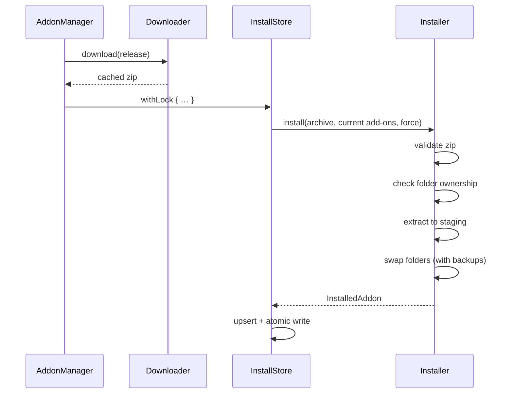

# Installing

How an add-on gets from a download onto disk: the install, update, rollback and uninstall flow, the safety checks, and the `Downloader`.

Code: `Sources/AddonKit/Install/` (`Downloader`, `ZipExtractor`, `Installer`). Records are kept by the `InstallStore` ([data-storage.md](../architecture/data-storage.md)). Why it works like a transaction: [decision 0004](../decisions/0004-transactional-installer.md).

## Install flow

The download happens first. The ownership check, the folder swap and the store write then run as one step under the cross-process store lock, so the app and the CLI can't interleave.

### 1. Validate (`ZipExtractor`)

Nothing touches disk until the whole archive passes these checks:
- Every entry must stay inside the destination. `..`, absolute paths, `C:` paths and symlink entries are rejected (`unsafeArchivePath`); this blocks "zip-slip" attacks.
- `__MACOSX/` and `.DS_Store` are ignored.
- There must be at least one top-level folder containing a `.toc`, and no stray top-level files. Otherwise the archive is `invalidArchive`.
- `Blizzard_*` folders are rejected.

### 2. Ownership (`Installer`)

For each top-level folder in the zip:

| On disk | Result |
|---|---|
| Owned by this add-on | Replaced |
| Owned by another managed add-on | `folderConflict(folder, owner)` |
| Exists but no add-on manages it | `unmanagedFolderExists` unless `force` (app: **Overwrite**; CLI: `--force`) |
| Doesn't exist | Created |

Folder names are compared case-insensitively.

### 3. Staging and swap

1. Extract into a staging folder on the same volume, so the moves are instant renames.
2. For each folder, move the old copy to a backup folder, then move the new copy in.
3. Folders the previous version owned but the new one doesn't ship are moved out too.
4. **If any step fails, the backups are restored in reverse order.** If restoring itself fails, the staging folder is kept so nothing is lost.

## Update, rollback, uninstall, adopt

| Operation | What happens |
|---|---|
| Update | Resolve the newest release ([release-selection.md](release-selection.md)); if it's newer (different release ID, later date), run the install flow. Up to 4 at once; pinned add-ons are skipped |
| Rollback | Reinstall `previousRelease` from the download cache, then pin. Fails with `noRollbackAvailable` if the zip is gone |
| Uninstall | Move the add-on's folders to the Trash (`FileManager.trashItem`), then remove the record. Folders already missing aren't an error |
| Adopt | Resolve the suggested repo and install over the unmanaged folder after confirmation |

If WoW is running, the CLI says to `/reload` after changes ([cli/output.md](../cli/output.md)). Installs aren't blocked.

## Downloader

- Downloads with `URLSession` and reports progress from 0 to 1.
- Reuses a cached zip when one exists. Concurrent requests for the same release share one download.
- Runs up to 4 downloads at once.
- Keeps the newest **2** zips per add-on, which is what rollback uses.
- The transport is a protocol (`DownloadTransport`), so tests serve zips without the network.
- Asset downloads never send the GitHub token ([github-endpoints.md](../network/github-endpoints.md)).

Cost: validating an 8 MB, 400-file zip takes 2.5 ms and extracting it 107 ms ([measurements](../performance/measurements.md)).
