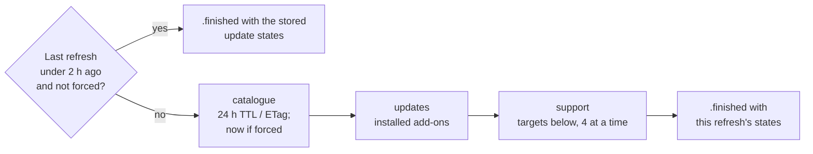

# Refresh

How the core's background refresh works: when it skips, its phases, which repos it checks, how polite it is, and how progress is reported.

Code: `Sources/AddonKit/AddonManager+Refresh.swift`. When the app calls it: [app/first-launch.md](../app/first-launch.md). Its place in the network schedule: [network/overview.md](../network/overview.md).

`AddonManager.refresh(in:force:)` → `AsyncStream<RefreshProgress>` does the background network work. `lastRefresh(in:)` says when it last finished for an installation (stored in `refresh_state`).

## Flow

| Phase | Work | Share of the progress bar |
|---|---|---|
| `catalogue` | revalidate the add-on catalogue ([search.md](search.md#the-catalogue-cataloguesource)) | 0–10% |
| `updates` | check installed add-ons for updates | 10–30% |
| `support` | check which add-ons support Forever | 30–100% |
| `finished` | carries the update states | 100% |

## Support targets

| Refresh | Repos checked |
|---|---|
| First ever for this installation | the 200 most recently updated catalogue repos with a `release.json`, plus installed add-ons |
| Later (every 2 h, or forced) | installed add-ons; repos whose catalogue `last_updated` is newer than their verdict; repos new to the catalogue (with `release.json`); the 20 oldest verdicts past 14 days |

- A forced refresh runs the installed checks and a catalogue revalidation at once, but never re-seeds.
- Repos without a `release.json` are never requested; search shows them as `.needsDownload`.
- Stored update states are corrected on the way out: an `.available` release that's since been installed comes back `.upToDate`.

## Who decides freshness

- Every target goes through `check(policy: .revalidateIfStale)`, which skips the network for answers still within their lifetime and stores what it learns. The target list is only a pre-filter.
- A forced refresh checks installed add-ons with `.forceRevalidate`.
- The support phase reuses what the update phase just stored.
- Rules and lifetimes: [decision 0011](../decisions/0011-single-cache-owner.md), [caching.md](../network/caching.md#lifetimes).

## Politeness

- github.com only, so no API quota for add-ons with `release.json`.
- 4 checks at a time, jittered retries, and a global pause on 429/403 ([github-endpoints.md](../network/github-endpoints.md#errors)).
- Requests stay off Low Data Mode networks (`allowsConstrainedNetworkAccess = false`).

## Progress

- Coalesced to about 10 Hz: counts and a short message ("Checked BigWigs"), never result lists.
- The stream keeps only the newest few elements. `.finished` is always last.
- Cancelling the consumer stops the work without recording a refresh.
- In the app, progress lives in `RefreshStatus`, observed only by the sidebar bar and the seeding sheet ([performance/guidelines.md](../performance/guidelines.md#progress-and-observation)).
