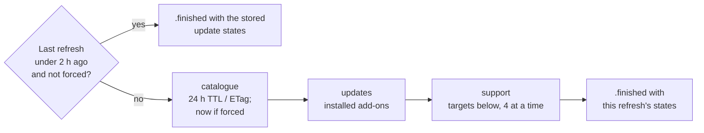

# Refresh

How the core's background refresh works: when it skips, its phases, which repos it checks, how polite it is, and how progress is reported.

Code: `Sources/AddonKit/AddonManager+Refresh.swift`. When the app calls it: [app/first-launch.md](../app/first-launch.md). Its place in the network schedule: [network/overview.md](../network/overview.md).

`AddonManager.refresh(in:force:)` → `AsyncStream<RefreshProgress>` does the background network work. `lastRefresh(in:)` says when it last finished for an installation (stored in `refresh_state`).

## Flow

| Phase | Work | Share of the progress bar |
|---|---|---|
| `catalogue` | revalidate the add-on catalogue ([search.md](search.md#the-catalogue-cataloguesource)) | 0–10% |
| `updates` | check installed add-ons for updates | 10–30% |
| `support` | check which add-ons support the installation's flavor | 30–100% |
| `finished` | carries the update states | 100% |

## Support targets

| Refresh | Repos checked |
|---|---|
| First ever for this installation | the 200 most recently updated catalogue repos with a `release.json` (100 once another installation has been refreshed), plus installed add-ons |
| Later (every 2 h, or forced) | installed add-ons; repos whose catalogue `last_updated` is newer than their verdict; repos new to the catalogue (with `release.json`); the 20 oldest verdicts past 14 days |

- A forced refresh runs the installed checks and a catalogue revalidation at once, but never re-seeds.
- Repos without a `release.json` are never requested; search shows them as `.needsDownload`.
- Stored update states are corrected on the way out: an `.available` release that's since been installed comes back `.upToDate`.

## Who decides freshness

- Every target goes through `check(policy: .revalidateIfStale)`, which skips the network for answers still within their lifetime and stores what it learns. The target list is only a pre-filter.
- A forced refresh checks installed add-ons with `.forceRevalidate`.
- The support phase reuses what the update phase just stored.
- **Update checks compare tags first.** An installed add-on whose latest tag equals its version is up to date without its `release.json`; only a new tag needs one, and that's stored by `repo@tag`, so a relaunch fetches none.
- **Tags are shared between flavors.** A latest tag any installation's check stored under an hour ago is reused, so a second installation's seed needs only the verdicts, from stored `release.json`s: often no requests at all.
- **Failures don't replace verdicts.** A failed check keeps the last good verdict on screen and is retried after 15 minutes. Refresh checks are background checks, so they never fall back to the API.
- **The API is throttled.** Add-ons only the API can decide (prerelease channel, no `release.json`, the latest release lacks the flavor) are asked at most every 6 hours per repo unless the latest tag changed; in between, the last stored update state stands ([caching.md](../network/caching.md#owners-and-cachepolicy)).
- Rules and lifetimes: [decision 0011](../decisions/0011-single-cache-owner.md), [caching.md](../network/caching.md#lifetimes).

## Politeness

- github.com only, so no API quota for add-ons with `release.json`; the rest are throttled to one API call per repo every 6 hours.
- 4 checks at a time, jittered retries, and a global pause on 429/403 ([github-endpoints.md](../network/github-endpoints.md#errors)).
- Requests stay off Low Data Mode networks (`allowsConstrainedNetworkAccess = false`).

## Visible-row checks

`AddonManager.checkVisible(_:in:)` fills in the Browse rows the user is looking at, so a search for something outside the seed (AutoPotion, say) doesn't stay "—". The app calls it about a second after scrolling stops ([app/layout.md](../app/layout.md#browse-table)).

- **Quota-free only.** Each ref is a background `latestRelease(policy: .revalidateIfStale)`: `HEAD releases/latest` on github.com, plus the tag's `release.json` when it isn't stored. Background checks never fall back to the API.
- Only refs without a fresh stored answer for the flavor (the same lifetimes as the refresh); a latest tag another flavor stored within the hour needs no request at all.
- At most **20 refs per call** (the rest wait for the next), **4 at a time**; `AddonManager.visibleCheckTargets(_:isChecked:)` picks them, unchecked rows first; refs already in flight from an earlier call are dropped, and duplicates count once.
- Skipped entirely while github.com is pausing requests (429/403 backoff) and on Low Data Mode (`NWPathMonitor` says the path is constrained). A pause mid-call stops the rest; so does cancelling the caller (a new query).
- Answers go through the normal store, so `database.changes()` reports them and the rows patch live. Cost per call: at most 20 HEADs plus one `release.json` per new tag ([budget.md](../network/budget.md)).

## Progress

- Coalesced to about 10 Hz: counts and a short message ("Checked BigWigs"), never result lists.
- The stream keeps only the newest few elements. `.finished` is always last.
- Cancelling the consumer stops the work without recording a refresh.
- In the app, progress lives in `RefreshStatus`, observed only by the sidebar bar and the seeding sheet ([performance/guidelines.md](../performance/guidelines.md#progress-and-observation)). Verdicts and flavors the refresh writes reach Browse rows live ([app/live-data.md](../app/live-data.md)).
- From the terminal: `addonctl refresh [--force]` ([cli/commands.md](../cli/maintenance.md#refresh)).
