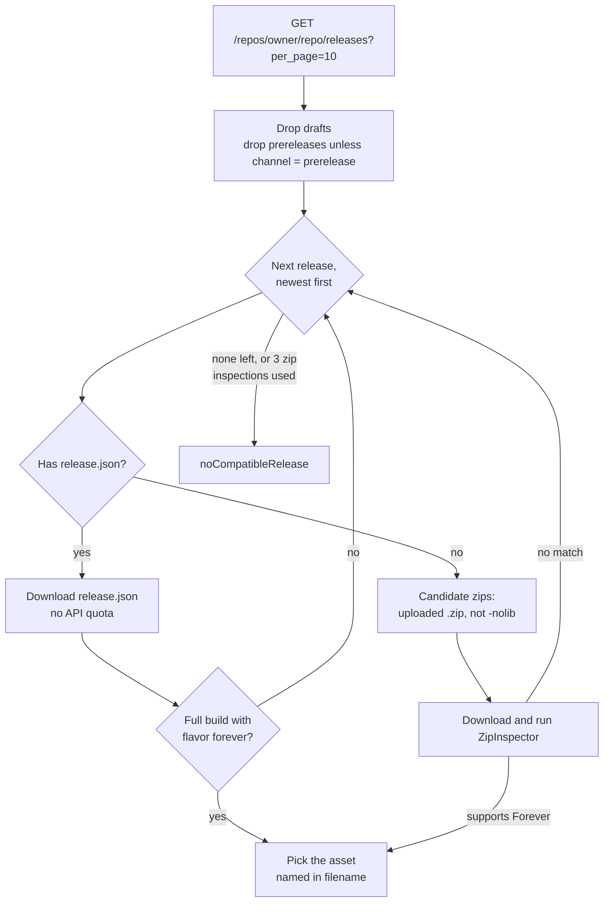
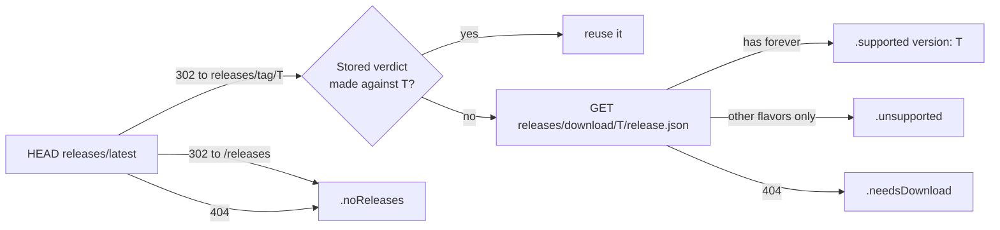

# Release selection

How `GitHubSource` finds the newest GitHub release of an add-on that supports Forever, and the right zip within it.

Code: `Sources/AddonKit/Sources/GitHubSource.swift`, `GitHubModels.swift`, `Selection/ReleaseSelector.swift`, `Selection/ZipInspector.swift`. Why `release.json` first: [decision 0003](../decisions/0003-forever-detection.md). The requests it makes: [github-endpoints.md](../network/github-endpoints.md).

## How a release is chosen



- Walking back to older releases handles authors who dropped Forever support: users stay on the last build that works.
- `ReleaseSelector` is pure and synchronous. When it needs data it doesn't have yet, it returns `.needsReleaseJSON` or `.needsInspection`. `GitHubSource` fetches that data and asks again, adding releases whose zips didn't match to an exclusion list.
- `noCompatibleRelease` shows as "No Forever build yet" in the app.

## Reasoning trail

Every `ResolvedRelease` carries a `reasoning` trail, for example:

```
["release v426.4 (id 123)", "release.json → BigWigs-v426.4.zip (forever 16001)"]
```

`addonctl resolve` and `addonctl info` print it ([cli/commands.md](../cli/commands.md)).

## ZipInspector: does a zip support Forever?

It uses the TOC file the game client itself would load:

1. Find add-on folders: a top-level folder `F` containing `F/F[suffix].toc`. `__MACOSX/` is ignored.
2. A Forever-specific TOC (`_Camelot`, `-Forever` and so on) means supported.
3. Otherwise the `_Mainline` TOC decides, and failing that the base TOC: it's supported if its `## Interface:` values include one in 16000–19999.

The same check runs on an add-on folder already on disk, which adopting uses. Suffixes and ranges come from [FlavorRules](../architecture/flavors.md).

## Quota-free resolve (stable channel)

`AddonManager.resolve` (stable channel) and stable update checks first ask `GitHubSource.latestRelease` for the latest release. When its `release.json` names a build for the flavor, the release is resolved without the API. The download URL is built as `github.com/{owner}/{repo}/releases/download/{tag}/{filename}`, so installing or updating BigWigs, DBM and other packager-built add-ons costs no API quota. Why: [decision 0010](../decisions/0010-quota-free-endpoints.md).

- It returns nil, and the caller falls back to the API flow above, when the latest release has no `release.json` or lacks the flavor (an older release might still have it).
- Such a release has no real release ID or date: `releaseID` is a negative hash of `owner/repo@tag` and `publishedAt` is the time of the check. `InstalledAddon.isUpdate` compares **tags** whenever either side has a synthetic ID, so a re-resolve never shows a false "update available".
- The prerelease channel always uses the API: `releases/latest` excludes prereleases.

## Inspection limits

- At most 2 candidate zips are inspected per release without a `release.json`, and at most 3 releases.
- Inspected zips are saved at the `Downloader`'s archive path, so the install reuses them and pruning cleans them up ([installing.md](installing.md#downloader)).

## Support checks

`check(_:flavor:policy:background:)` (and `support(for:flavor:)`, the `SupportChecking` protocol) costs **no API quota**. It looks only at the latest stable release:



| Outcome | `SupportStatus` |
|---|---|
| Latest release's `release.json` lists Forever | `.supported(version: tag)` |
| It lists only other flavors | `.unsupported` |
| Latest release has no `release.json` | `.needsDownload` |
| No releases, or the repo is gone | `.noReleases` |
| Anything else failed | `.unknown` (stored as an `error` row, never shown) |

- `GitHubSource` is the **only owner** of verdicts and latest tags; callers pass a `CachePolicy` and never judge freshness themselves ([decision 0011](../decisions/0011-single-cache-owner.md)). How long each outcome is reused: [caching.md](../network/caching.md#lifetimes).
- Concurrent lookups for the same repo and flavor share one request.
- If github.com fails for a reason other than pushing back (429/403), `apiSupport(for:flavor:)`, the API path, answers while quota is comfortable. It also looks past the latest release, and keeps a 10-call reserve.
- `background: true` requests stay off constrained (Low Data Mode) networks.

## Parsing refs

`parse(_:)` accepts:
- `owner/repo` and `github:owner/repo`
- `https://github.com/owner/repo`, with or without `www.`, `.git` or a trailing slash
- repo URLs ending in `/releases…`, `/tags`, `/tree/…` or `/blob/…`

Case is preserved. Name lookup (`AddonManager.lookup`) is described in [core.md](../architecture/core.md#behaviour-worth-knowing).
