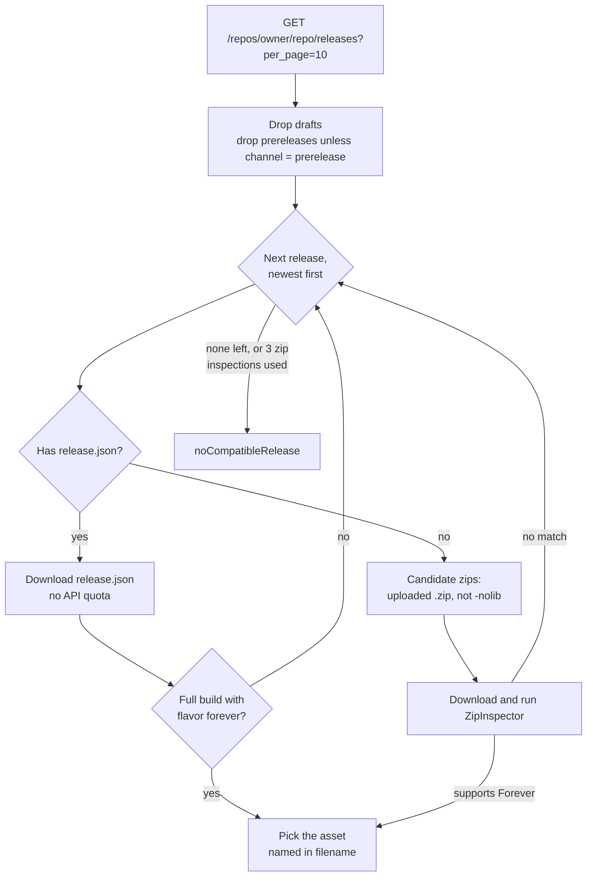

# Release selection

How `GitHubSource` finds the newest GitHub release of an add-on that supports Forever, and the right zip within it.

Code: `Sources/AddonKit/Sources/GitHubSource.swift`, `GitHubModels.swift`, `Selection/ReleaseSelector.swift`, `Selection/ZipInspector.swift`. Why `release.json` first: [decision 0003](../decisions/0003-forever-detection.md). The requests it makes: [github-endpoints.md](../network/github-endpoints.md).

## How a release is chosen



- Walking back to older releases handles authors who dropped Forever support: users stay on the last build that works.
- `ReleaseSelector` is pure and synchronous. When it needs data it doesn't have yet, it returns `.needsReleaseJSON` or `.needsInspection`. `GitHubSource` fetches that data and asks again, adding releases whose zips didn't match to an exclusion list.
- `noCompatibleRelease` shows as "No Forever build yet" in the app.

## Reasoning trail

Every `ResolvedRelease` carries a `reasoning` trail, for example:

```
["release v426.4 (id 123)", "release.json → BigWigs-v426.4.zip (forever 16001)"]
```

`addonctl resolve` and `addonctl info` print it ([cli/commands.md](../cli/commands.md)).

## ZipInspector: does a zip support Forever?

It uses the TOC file the game client itself would load:

1. Find add-on folders: a top-level folder `F` containing `F/F[suffix].toc`. `__MACOSX/` is ignored.
2. A Forever-specific TOC (`_Camelot`, `-Forever` and so on) means supported.
3. Otherwise the `_Mainline` TOC decides, and failing that the base TOC: it's supported if its `## Interface:` values include one in 16000–19999.

The same check runs on an add-on folder already on disk, which adopting uses. Suffixes and ranges come from [FlavorRules](../architecture/flavors.md).

## Support checks (for search)

`support(for:flavor:)` (the `SupportChecking` protocol) runs the same selection but **never downloads zips**:

| Outcome | `SupportStatus` |
|---|---|
| Found a Forever build | `.supported(version:)` |
| Releases, but none for Forever | `.unsupported` |
| No eligible stable release | `.noReleases` |
| No `release.json`; confirming needs a download | `.needsDownload` |
| Error, or quota ≤ 10 calls left | `.unknown` (never cached) |

The 10-call reserve keeps search from using up the quota that installs and updates need. How long results are kept: [caching.md](../network/caching.md).

> **Landing with the core merge:** support and latest-tag data move into SQLite, owned by `GitHubSource.check`, which uses the quota-free `releases/latest` redirect and `release.json` download first ([decision 0010](../decisions/0010-quota-free-endpoints.md), [decision 0011](../decisions/0011-single-cache-owner.md)). The prerelease channel still needs the API release list.

## Parsing refs

`parse(_:)` accepts:
- `owner/repo` and `github:owner/repo`
- `https://github.com/owner/repo`, with or without `www.`, `.git` or a trailing slash
- repo URLs ending in `/releases…`, `/tags`, `/tree/…` or `/blob/…`

Case is preserved. Name lookup (`AddonManager.lookup`) is described in [core.md](../architecture/core.md#behaviour-worth-knowing).
