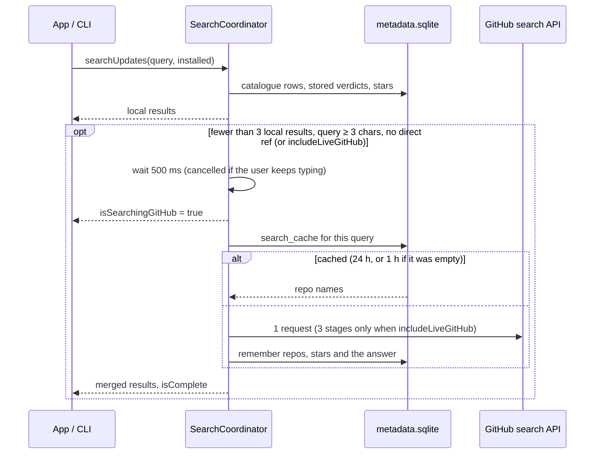

# Search and Browse

How a query is searched (layers, the GitHub fallback, matching, ranking, aliases), how the catalogue is imported, and what Browse shows with an empty query.

Search powers the app's Browse tab and `addonctl search`. Code: `Sources/AddonKit/Search/`, `Store/MetadataDatabase.swift`.

**Search reads the local database; if it finds too little, it asks GitHub once and remembers the answer.** Other network work happens in [refresh](refresh.md) and when you open, install or update a specific add-on. Why: [decision 0009](../decisions/0009-local-first-search.md).

## Layers

| Layer | Data | Network |
|---|---|---|
| Installed | `InstallStore` + unmanaged folders' TOCs (or the list the caller passes) | none |
| Direct ref | query looks like `owner/repo` or a GitHub URL | none |
| Catalogue | `catalogue` table: [github-wow-addon-catalogue](https://github.com/layday/github-wow-addon-catalogue) rows plus repos earlier live searches found | none, except the very first download if the database is empty |
| GitHub live | `api.github.com/search/repositories` | only as the fallback below, or when `includeLiveGitHub` is set |

## How a search runs

- **No support checks during search.** Results carry the stored verdict. Catalogue rows without a `release.json` show `.needsDownload`, since nothing cheaper could tell. Everything else is `.unknown` until it's opened, installed or refreshed. `.checking` is never emitted.
- `search(_:installed:)` returns plain result arrays; `searchUpdates(_:installed:)` returns `SearchUpdate { results, isSearchingGitHub, isComplete }`. `AddonManager` has both, plus `search(_:in:installed:)` so the caller's add-on list is used instead of rescanning `AddOns/` per keystroke.
- Results are deduplicated by ref, and their `origin` sets are merged.
- Cancelling the consumer cancels any work still running.
- **Forever only** (on by default) hides `.unsupported` and `.noReleases` results. Installed add-ons and direct refs always stay.

## GitHub fallback

- **Trigger:** fewer than 3 local results, a query of 3+ characters and no direct ref; or **Search GitHub for More Results** / `addonctl search --github` (`includeLiveGitHub`).
- **Request:** `q=<terms> in:name,description topic:wow-addon`, sorted by recently updated, 30 per page. With `includeLiveGitHub`, fewer than 5 results retry with `topic:world-of-warcraft-addon`, then with no topic but `wow OR warcraft` added. Archived repos and forks are dropped.
- **Remembered:** found repos are added to the `catalogue` table (`source = 'github_search'`) with their stars, and the query's answer goes in `search_cache` for 24 h (1 h if empty).
- **Limits:** the search API allows 10 requests a minute without a token, 30 with one. The remaining count and reset time are stored in `rate_limit` (resource `search`), shared by the app and CLI. While none are left the fallback is skipped quietly; a 403 with no reset header waits 60 s.

## Matching and ranking (`SearchIndex`)

The in-memory `SearchIndex` is built from one `SELECT` of the catalogue table, and rebuilt only when the rows change. FTS5 is available in the system SQLite, but it can't reproduce these tiers or the aliases, and both take under 2 ms, so ranking stays in Swift ([decision 0008](../decisions/0008-sqlite-metadata-database.md)).

- **Matching:**
  - Case and accents are ignored.
  - Words are split on punctuation and camelCase, so "boss" matches DeadlyBossMods.
  - Every query word must match a word in the name, owner, repo or description. The last word may match as a prefix.
  - **Aliases:** `dbm`, `bw`, `lw`, `wa`/`wa2`, `tsm`, `bt4`, `rcl`, `mrt`, `ert`, `elv`, `bossmods`. They're defined in `SearchAliases.swift`.
- **Ranking**, highest first:
  1. Exact name match
  2. Name starts with the query
  3. All words in the name
  4. Match in the description

  Within each tier, results sort by support (supported, then unknown, then unsupported), then by most recently updated.

Known quirk: "bag" ranks the Bagnon plugins above BetterBags, because a name starting with the query outranks a word inside a camelCase name.

## The catalogue (`CatalogueSource`)

- **Download:** one raw.githubusercontent.com request (no API quota), at most every 24 h, revalidated with `If-None-Match`.
- **Stale while revalidating:** an old copy is returned at once and refreshed in the background.
- **Offline:** a failed download isn't retried for 15 minutes. The failure time is stored, so the app and CLI share the backoff.
- **Import:** all rows are upserted in one transaction. `ON CONFLICT … DO UPDATE … WHERE (columns) IS NOT (new values)` leaves unchanged rows alone, so `refresh()` returns a `CatalogueDiff` of the repos that actually changed. Rows that left the file are deleted; rows found by live search are kept.
- The catalogue's `flavors` column under-reports Forever, so it isn't trusted; verdicts come from [support checks](release-selection.md#support-checks).

## Browse (empty query)

`AddonManager.browse(in:)` is local only:
- **Popular:** add-ons with a stored "supported" verdict, sorted by stars when known.
- **Recently updated:** catalogue entries with the newest update dates.
- **Categories:** Boss mods, Bags, UI, Quests, Maps, Auction and Combat. Each is a saved keyword query from `SearchAliases.categories`; clicking one runs that search.

Results that are already installed are marked. How the app shows these lists: [app/layout.md](../app/layout.md#browse-table).
