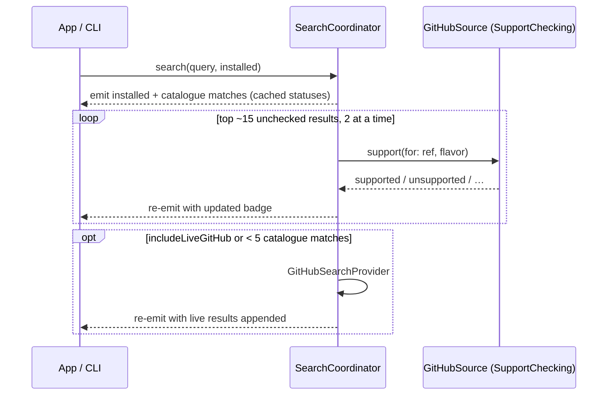

# Search and Browse

How a query is searched (layers, matching, ranking, aliases, the GitHub fallback) and what Browse shows with an empty query.

Search powers the app's Browse tab and `addonctl search`. Results stream back as each layer finishes. Code: `Sources/AddonKit/Search/`.

> **Changing with the core merge** ([decision 0009](../decisions/0009-local-first-search.md)): search, browse, sort and categories read only the local SQLite database. Support checks no longer run per search. GitHub is asked automatically only when a 3+ character query has fewer than 3 local matches. Sections below say which behaviour is which.

## Layers

| Layer | Data | Cost | Runs |
|---|---|---|---|
| Installed | `InstallStore` + unmanaged folders' TOCs | local | always, first |
| Catalogue | [github-wow-addon-catalogue](https://github.com/layday/github-wow-addon-catalogue) `addons.csv` (~2.4k repos) | one raw download per 24 h, no API quota | always |
| Direct ref | query looks like `owner/repo` or a GitHub URL | none | immediately |
| GitHub live | `api.github.com/search/repositories` | 10 searches/min without a token | see [GitHub fallback](#github-fallback) |

The catalogue's `flavors` column under-reports Forever, so it isn't trusted. Support comes from [support checks](release-selection.md#support-checks-for-search).

## How a search runs (this branch)

The per-search support loop is what made typing "bigwigs" cost 21 API calls in the [baseline](../network/budget.md). After the core merge, badges come from the database, filled by [refresh](../network/overview.md).

- Results are deduplicated by ref, and their `origin` sets are merged.
- Cancelling the consumer cancels any work still running.
- **Forever only** (on by default) hides `.unsupported` and `.noReleases` results. Installed add-ons and direct refs always stay.

## Matching and ranking (`SearchIndex`)

- **Matching:**
  - Case and accents are ignored.
  - Words are split on punctuation and camelCase, so "boss" matches DeadlyBossMods.
  - Every query word must match a word in the name, owner, repo or description. The last word may match as a prefix.
  - **Aliases:** `dbm`, `bw`, `lw`, `wa`/`wa2`, `tsm`, `bt4`, `rcl`, `mrt`, `ert`, `elv`, `bossmods`. They're defined in `SearchAliases.swift`.
- **Ranking**, highest first:
  1. Exact name match
  2. Name starts with the query
  3. All words in the name
  4. Match in the description

  Within each tier, results sort by support (supported, then unknown, then unsupported), then by most recently updated.

Known quirk: "bag" ranks the Bagnon plugins above BetterBags, because a name starting with the query outranks a word inside a camelCase name.

The index stays in memory rather than SQLite FTS5, because FTS5 can't reproduce these tiers or aliases ([decision 0008](../decisions/0008-sqlite-metadata-database.md)). Build: 63 ms; per keystroke p50 0.29 ms ([measurements](../performance/measurements.md)).

## GitHub fallback

| | This branch | After the core merge |
|---|---|---|
| Automatic trigger | fewer than 5 catalogue matches | fewer than 3 local matches and a query of 3+ characters |
| Manual trigger | **Search GitHub for More Results**, `addonctl search --github` | same |
| Results | in memory, per query, 10 min | written into the local catalogue; query cached 24 h (empty result 1 h) |

The request is `q=<terms> in:name,description topic:wow-addon`, sorted by recently updated, 30 per page.
- If that finds fewer than 5 results, it retries with `topic:world-of-warcraft-addon`, then with no topic but with `wow OR warcraft` added to the terms.
- Archived repos and forks are dropped.
- A rate limit stops this layer quietly; the rest of the search continues. The search API allows 10 requests a minute without a token.

## Browse (empty query)

`AddonManager.browse(in:)` returns:
- **Popular:** add-ons already confirmed to support Forever, sorted by stars when known.
- **Recently updated:** catalogue entries with the newest update dates.
- **Categories:** Boss mods, Bags, UI, Quests, Maps, Auction and Combat. Each is a saved keyword query from `SearchAliases.categories`; clicking one runs that search.

Results that are already installed are marked. How the app shows these lists: [app/layout.md](../app/layout.md#browse-table).

## Caches

Catalogue, support and live-search caches are listed in [caching.md](../network/caching.md).
