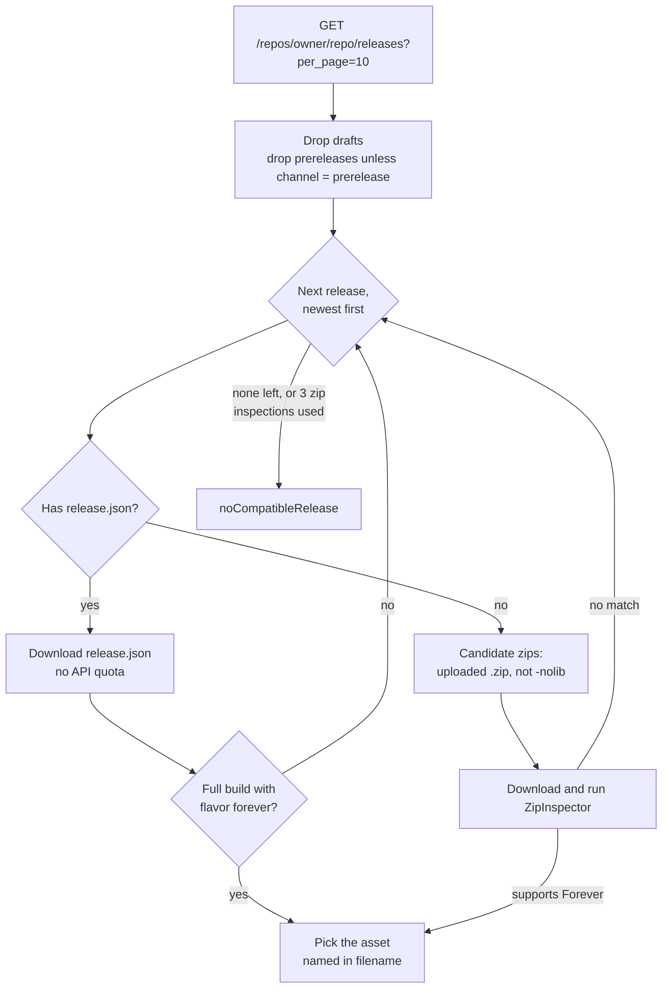
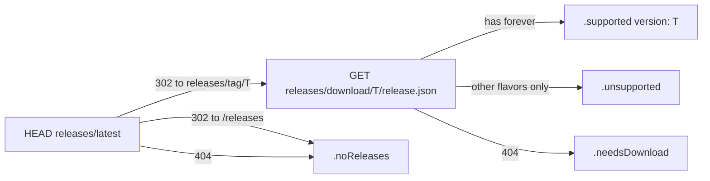

# GitHub source

Finds the newest GitHub release of an add-on that supports Forever, and the right zip within it.

Code: `Sources/AddonKit/Sources/GitHubSource.swift`, `GitHubModels.swift`, `Selection/ReleaseSelector.swift`, `Selection/ZipInspector.swift`.

## How a release is chosen

`ReleaseSelector` is pure and synchronous. When it needs data it doesn't have yet, it returns `.needsReleaseJSON` or `.needsInspection`. `GitHubSource` then fetches that data and asks again, adding releases whose zips didn't match to an exclusion list.

Every `ResolvedRelease` carries a `reasoning` trail, for example `["release v426.4 (id 123)", "release.json → BigWigs-v426.4.zip (forever 16001)"]`. `addonctl resolve` prints it.

## ZipInspector: does a zip support Forever?

It uses the TOC file the game client itself would load:

1. Find add-on folders: a top-level folder `F` containing `F/F[suffix].toc`. `__MACOSX/` is ignored.
2. A Forever-specific TOC (`_Camelot`, `-Forever` and so on) means supported.
3. Otherwise the `_Mainline` TOC decides, and failing that the base TOC: it's supported if its `## Interface:` values include one in 16000–19999.

The same check runs on an add-on folder already on disk, which adopting uses.

## Requests

| What | Where | Counts against API quota |
|---|---|---|
| Release list | `api.github.com/repos/{owner}/{repo}/releases?per_page=10` | Yes |
| `release.json`, zips | each asset's `browser_download_url` | No |
| Latest stable tag | `HEAD github.com/{owner}/{repo}/releases/latest` (redirects to `…/releases/tag/{tag}`) | No |
| Latest release's `release.json` | `github.com/{owner}/{repo}/releases/download/{tag}/release.json` | No |

- **Headers:** `Accept: application/vnd.github+json`, `X-GitHub-Api-Version: 2022-11-28` and the app's User-Agent. `Authorization: Bearer` is added only when a token is set, and never on asset downloads.
- **ETags:** the caller's ETag is sent as `If-None-Match`, and a 304 returns `.notModified`. Without a caller ETag, the source still revalidates its own in-memory cache.
- **Errors:**
  - 404 → `notFound`
  - 403 or 429 with no remaining quota (or a `retry-after` header) → `rateLimited(resetAt:)`
  - any other non-2xx status → `http`
- **Rate limit:** `rateLimit()` reports the latest `x-ratelimit-remaining` and reset time. Without a token, GitHub allows 60 calls per hour. `quotaIsComfortable()` is true above 30 calls left (or before any call); optional API calls such as the README fallback wait for it.
- **github.com requests** (the free routes) never send the token. A 429 or 5xx is retried twice with backoff (2 s, 4 s, or the `Retry-After`). A 429 that persists, or asks to wait more than 30 s, pauses every github.com request until it's over.

### Caches

| What | Where |
|---|---|
| Decoded `release.json` | in memory and at `<caches>/github/release-json/<asset id>.json` |
| Inspected zips | `<caches>/downloads/github/<asset id>-<name>` |

## Support checks (for search)

`support(for:flavor:)` (the `SupportChecking` protocol) costs **no API quota**. It looks only at the latest stable release:

| Outcome | `SupportStatus` |
|---|---|
| Latest release's `release.json` lists Forever | `.supported(version: tag)` |
| It lists only other flavors | `.unsupported` |
| No releases, or the repo is gone | `.noReleases` |
| Latest release has no `release.json` | `.needsDownload` |
| github.com failed and the API fallback couldn't answer | `.unknown` (never cached) |

- `latestTag(for:)` is the first step on its own. Answers are reused for 10 minutes, so a refresh's update and support phases share one request per repo.
- `release.json` is cached on disk per tag (`<caches>/github/release-json/tags/`), so rechecking an unchanged repo is a single `HEAD`.
- If github.com fails for another reason, the old API path, `apiSupport(for:flavor:)`, is used while quota is comfortable. It also looks past the latest release, and keeps a 10-call reserve.

Results are cached in memory for 6 hours, and persistently by the metadata database (see [search.md](search.md)).

## Parsing refs

`parse(_:)` accepts:
- `owner/repo` and `github:owner/repo`
- `https://github.com/owner/repo`, with or without `www.`, `.git` or a trailing slash
- repo URLs ending in `/releases…`, `/tags`, `/tree/…` or `/blob/…`

Case is preserved.
