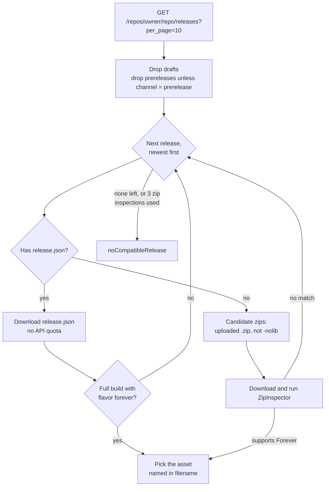

# GitHub source

Finds the newest GitHub release of an add-on that supports Forever, and the right zip within it.

Code: `Sources/AddonKit/Sources/GitHubSource.swift`, `GitHubModels.swift`, `Selection/ReleaseSelector.swift`, `Selection/ZipInspector.swift`.

## How a release is chosen

`ReleaseSelector` is pure and synchronous. When it needs data it doesn't have yet, it returns `.needsReleaseJSON` or `.needsInspection`. `GitHubSource` then fetches that data and asks again, adding releases whose zips didn't match to an exclusion list.

Every `ResolvedRelease` carries a `reasoning` trail, for example `["release v426.4 (id 123)", "release.json → BigWigs-v426.4.zip (forever 16001)"]`. `addonctl resolve` prints it.

## ZipInspector: does a zip support Forever?

It uses the TOC file the game client itself would load:

1. Find add-on folders: a top-level folder `F` containing `F/F[suffix].toc`. `__MACOSX/` is ignored.
2. A Forever-specific TOC (`_Camelot`, `-Forever` and so on) means supported.
3. Otherwise the `_Mainline` TOC decides, and failing that the base TOC: it's supported if its `## Interface:` values include one in 16000–19999.

The same check runs on an add-on folder already on disk, which adopting uses.

## Requests

| What | Where | Counts against API quota |
|---|---|---|
| Release list | `api.github.com/repos/{owner}/{repo}/releases?per_page=10` | Yes |
| `release.json`, zips | each asset's `browser_download_url` | No |

- **Headers:** `Accept: application/vnd.github+json`, `X-GitHub-Api-Version: 2022-11-28` and the app's User-Agent. `Authorization: Bearer` is added only when a token is set, and never on asset downloads.
- **ETags:** the caller's ETag is sent as `If-None-Match`, and a 304 returns `.notModified`. Without a caller ETag, the source still revalidates its own in-memory cache.
- **Errors:**
  - 404 → `notFound`
  - 403 or 429 with no remaining quota (or a `retry-after` header) → `rateLimited(resetAt:)`
  - any other non-2xx status → `http`
- **Rate limit:** `rateLimit()` reports the latest `x-ratelimit-remaining` and reset time. Without a token, GitHub allows 60 calls per hour.

### Caches

| What | Where |
|---|---|
| Decoded `release.json` | in memory and at `<caches>/github/release-json/<asset id>.json` |
| Inspected zips | `<caches>/downloads/github/<asset id>-<name>` |

## Support checks (for search)

`support(for:flavor:)` (the `SupportChecking` protocol) runs the same selection but **never downloads zips**:

| Outcome | `SupportStatus` |
|---|---|
| Found a Forever build | `.supported(version:)` |
| Releases, but none for Forever | `.unsupported` |
| No eligible stable release | `.noReleases` |
| No `release.json`; confirming needs a download | `.needsDownload` |
| Error, or quota ≤ 10 calls left | `.unknown` (never cached) |

Results are cached in memory for 6 hours. The 10-call reserve keeps search from using up the quota that installs and updates need.

## Parsing refs

`parse(_:)` accepts:
- `owner/repo` and `github:owner/repo`
- `https://github.com/owner/repo`, with or without `www.`, `.git` or a trailing slash
- repo URLs ending in `/releases…`, `/tags`, `/tree/…` or `/blob/…`

Case is preserved.
