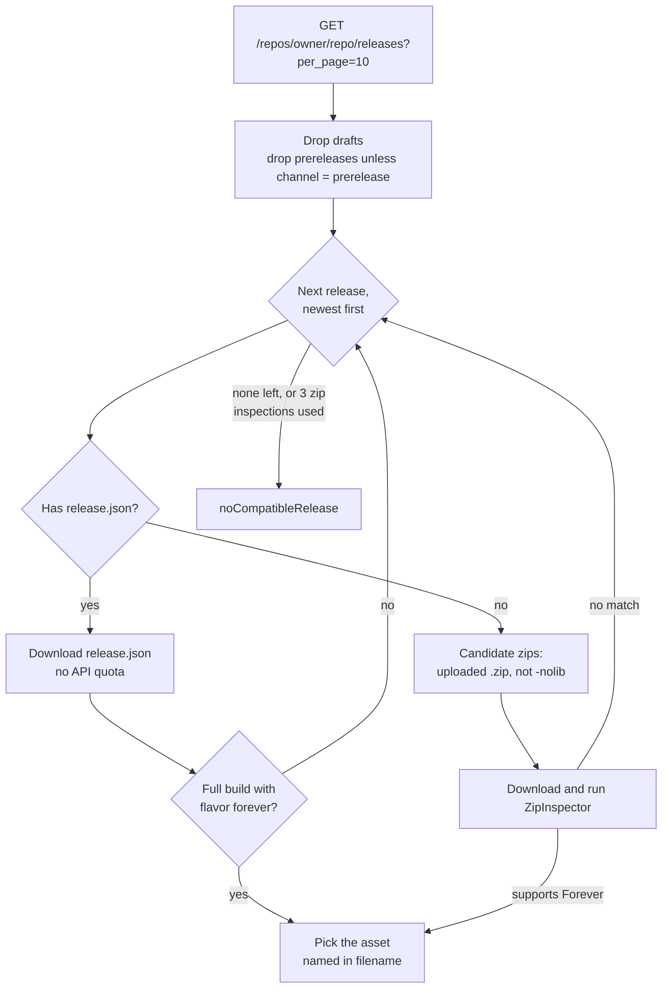
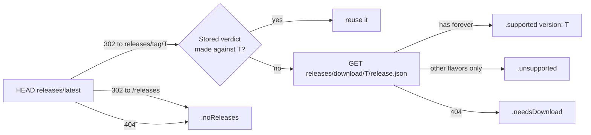

# GitHub source

Finds the newest GitHub release of an add-on that supports Forever, and the right zip within it.

Code: `Sources/AddonKit/Sources/GitHubSource.swift`, `GitHubModels.swift`, `Selection/ReleaseSelector.swift`, `Selection/ZipInspector.swift`.

## How a release is chosen

`ReleaseSelector` is pure and synchronous. When it needs data it doesn't have yet, it returns `.needsReleaseJSON` or `.needsInspection`. `GitHubSource` then fetches that data and asks again, adding releases whose zips didn't match to an exclusion list.

Every `ResolvedRelease` carries a `reasoning` trail, for example `["release v426.4 (id 123)", "release.json → BigWigs-v426.4.zip (forever 16001)"]`. `addonctl resolve` prints it.

## ZipInspector: does a zip support Forever?

It uses the TOC file the game client itself would load:

1. Find add-on folders: a top-level folder `F` containing `F/F[suffix].toc`. `__MACOSX/` is ignored.
2. A Forever-specific TOC (`_Camelot`, `-Forever` and so on) means supported.
3. Otherwise the `_Mainline` TOC decides, and failing that the base TOC: it's supported if its `## Interface:` values include one in 16000–19999.

The same check runs on an add-on folder already on disk, which adopting uses.

## Quota-free resolve (stable channel)

`AddonManager.resolve` (stable channel) and stable update checks first use the latest release from `latestRelease` (see [the decision below](#decision-one-owner-for-support-state-chosen-by-cache-policy)). When its `release.json` names a build for the flavor, the release is resolved without the API. The download URL is built as `github.com/{owner}/{repo}/releases/download/{tag}/{filename}`, so installing or updating BigWigs, DBM and other packager-built add-ons costs no API quota.

- It returns nil, and the caller falls back to the API resolve above, when the latest release has no `release.json` or lacks the flavor (an older release might still have it).
- Such a release has no real release ID or date: `releaseID` is a negative hash of `owner/repo@tag` and `publishedAt` is the time of the check. `InstalledAddon.isUpdate` compares **tags** whenever either side has a synthetic ID, so a re-resolve never shows a false "update available".
- The prerelease channel always uses the API: `releases/latest` excludes prereleases.

## Requests

| What | Where | Counts against API quota |
|---|---|---|
| Release list | `api.github.com/repos/{owner}/{repo}/releases?per_page=10` | Yes, including a 304 when unauthenticated |
| `release.json`, zips | each asset's `browser_download_url` | No |
| Latest stable tag | `HEAD github.com/{owner}/{repo}/releases/latest`, redirect **not followed**; the tag is read from `Location: …/releases/tag/{tag}` | No |
| A tag's `release.json` or asset | `github.com/{owner}/{repo}/releases/download/{tag}/{file}` | No |
| README fallback | `api.github.com/repos/{owner}/{repo}/readme` (only with a token) | Yes |

- **Headers:** `Accept: application/vnd.github+json`, `X-GitHub-Api-Version: 2022-11-28` and the app's User-Agent. `Authorization: Bearer` is added only when a token is set, and never on github.com or asset requests.
- **ETags:** the caller's ETag is sent as `If-None-Match`, and a 304 returns `.notModified`. Without a caller ETag, the source still revalidates its own in-memory copy (the last 64 repos).
- **Errors:**
  - 404 → `notFound`
  - 403 or 429 with no remaining quota, a `retry-after` header, or a "secondary rate limit" message → `rateLimited(resetAt:)`; with neither header it waits at least 60 s
  - any other non-2xx status → `http`
- **Rate limit:** `rateLimit()` reports the latest remaining count and reset time. It's stored in the database (`rate_limit`, resource `core`), so the app and CLI share it, and no API request is sent while it says 0 calls are left before the reset. Without a token, GitHub allows 60 calls per hour. `quotaIsComfortable()` is true above 30 calls left (or when nothing is known); optional API calls wait for it.
- **github.com requests** never send the token. A 429 or 5xx is retried twice with jittered backoff (about 2 s, 4 s, or the `Retry-After`). A 429 that persists or asks to wait more than 30 s, or any 403, pauses every github.com request until it's over (at least 60 s for a 403).

### Caches

| What | Where |
|---|---|
| Decoded `release.json` (API path) | in memory and at `<caches>/github/release-json/<asset id>.json` |
| `release.json` by tag (github.com path) | in memory; the stored verdict's tag avoids refetching it across launches |
| Inspected zips | the `Downloader`'s archive path, so the install reuses them and pruning cleans them up |

At most 2 candidate zips are inspected per release without a `release.json`, and at most 3 releases.

## Support checks

`check(_:flavor:policy:background:)` (and `support(for:flavor:)`, the `SupportChecking` protocol) costs **no API quota**. It looks only at the latest stable release:

| Outcome | `SupportStatus` | Reused by `.revalidateIfStale` for |
|---|---|---|
| Latest release's `release.json` lists Forever | `.supported(version: tag)` | 1 h |
| It lists only other flavors | `.unsupported` | 1 h |
| Latest release has no `release.json` | `.needsDownload` | 1 h |
| No releases, or the repo is gone | `.noReleases` | 24 h (a negative result) |
| Anything else failed | `.unknown` | 15 min (stored as an `error` row, never shown) |

- If github.com fails for a reason other than pushing back (429/403), `apiSupport(for:flavor:)`, the old API path, answers while quota is comfortable. It also looks past the latest release, and keeps a 10-call reserve.
- `background: true` requests stay off constrained networks.

## Decision: one owner for support state, chosen by cache policy

**Context.** Support verdicts and latest tags were cached in two places, an in-memory cache in `GitHubSource` and the SQLite `support` table, and callers decided freshness between them (checking `isFresh`, passing `reuse:`/`maxAge:` flags, or calling the tag and `release.json` lookups directly). That duplicated the "latest tag → release.json" logic and made it easy to force a request every time, or to trust an answer that was too old.

**Decision.**
1. **Single owner.** `GitHubSource.latestRelease(for:flavor:policy:)` is the only code that decides support. It reads and writes the stored verdicts and latest tags itself (`SupportCache` over the `support` and `repo_meta` tables). There is no other support cache. The raw lookups (`fetchLatestTag`, `webReleaseJSON`) are private to `GitHubSource`; callers never judge freshness. A test checks that no other file reaches them.
2. **Cache policy instead of flags:**

   | `CachePolicy` | Network | Store |
   |---|---|---|
   | `.preferStored` | never | read only; `.unknown` if nothing is stored |
   | `.revalidateIfStale` | only when the stored answer is past its lifetime (table above) | writes what it learns |
   | `.forceRevalidate` | always asks for the latest tag; still reuses the stored verdict when the tag is unchanged | writes what it learns |
3. **One shared primitive.** `latestRelease` answers "what's the latest stable release, and does it support the flavor" (`LatestRelease { tag, status, build }`). `check` returns its verdict; update checks use the same answer (and its `release.json` build) to decide "up to date" or build a quota-free `ResolvedRelease`; installs use it through `quotaFreeResolve`.
4. **Concurrent callers share one request:** a second lookup for the same repo and flavor waits for the first.

**Who uses which policy:**

| Caller | Policy |
|---|---|
| Search and Browse | none: they read stored verdicts only |
| Opening details | `.revalidateIfStale` |
| Background refresh (every 2 h): update and support phases | `.revalidateIfStale`; the support phase reuses what the update phase just stored |
| Explicit check (⌘R, `checkForUpdates`, `addonctl outdated`/`update`), forced refresh, install, `update` | `.forceRevalidate` |

**Consequences.** Freshness rules live in one place (`SupportCache` lifetimes plus the policy). A forced check of an unchanged repo costs one `HEAD`. The refresh may still pre-filter its targets as an optimisation, but `check` remains the authority. Writes happen per check rather than in caller-side batches.

## Parsing refs

`parse(_:)` accepts:
- `owner/repo` and `github:owner/repo`
- `https://github.com/owner/repo`, with or without `www.`, `.git` or a trailing slash
- repo URLs ending in `/releases…`, `/tags`, `/tree/…` or `/blob/…`

Case is preserved.
