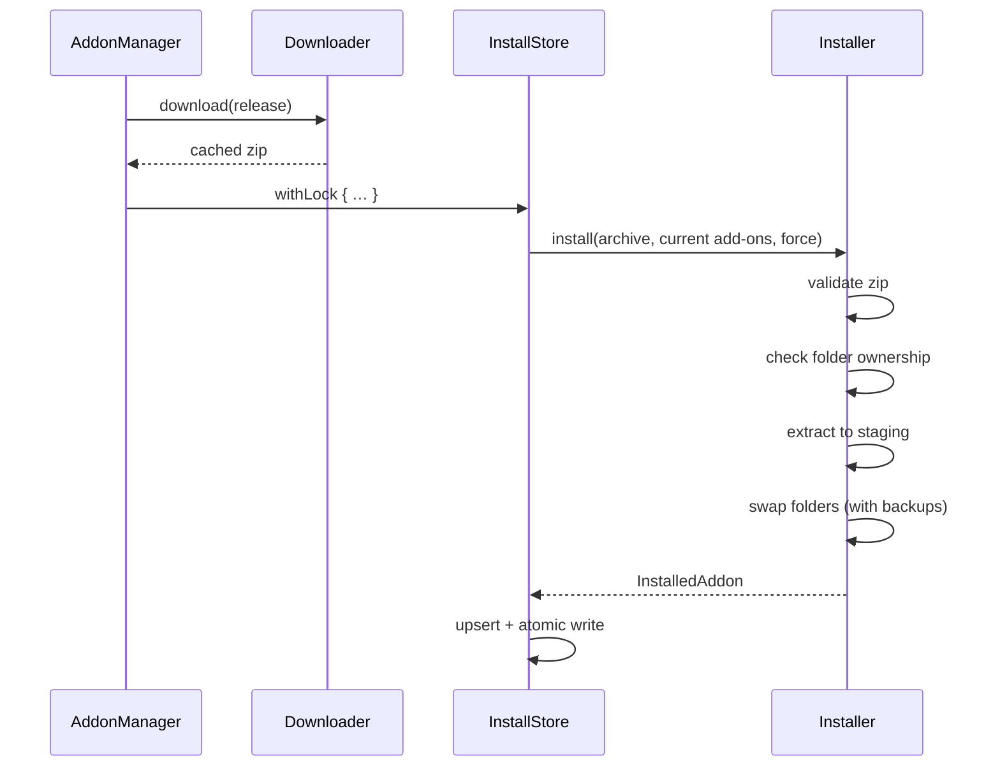

# Installing, storage and finding WoW

How add-ons get from a download onto disk, how the app remembers what it installed, and how it finds WoW.

Code: `Sources/AddonKit/Install/` and `Sources/AddonKit/Store/`.

## Where things live

| What | Path |
|---|---|
| Installed add-on records | `~/Library/Application Support/com.andrewmiotke.ForeverAddons/installations/<installation id>.json` |
| Store lock | `…/installations/.lock` |
| Downloaded zips | `~/Library/Caches/com.andrewmiotke.ForeverAddons/downloads/<source>/<owner+repo>/<releaseID>-<asset>` |
| Catalogue and support caches | `~/Library/Caches/com.andrewmiotke.ForeverAddons/` |
| Add-ons | `<WoW>/_classic_beta_/Interface/AddOns/` |

`AppDirectories` resolves these. `AppDirectories(root:)` puts everything under one folder, which is what tests and `ADDONS_DATA_DIR` use. Nothing is ever written into the game folder except the add-on folders themselves.

## Install flow

### 1. Validate (`ZipExtractor`)

Nothing touches disk until the whole archive passes these checks:
- Every entry must stay inside the destination. `..`, absolute paths, `C:` paths and symlink entries are rejected (`unsafeArchivePath`); this blocks "zip-slip" attacks.
- `__MACOSX/` and `.DS_Store` are ignored.
- There must be at least one top-level folder containing a `.toc`, and no stray top-level files. Otherwise the archive is `invalidArchive`.
- `Blizzard_*` folders are rejected.

### 2. Ownership (`Installer`)

For each top-level folder in the zip:

| On disk | Result |
|---|---|
| Owned by this add-on | Replaced |
| Owned by another managed add-on | `folderConflict(folder, owner)` |
| Exists but no add-on manages it | `unmanagedFolderExists` unless `force` |
| Doesn't exist | Created |

Folder names are compared case-insensitively.

### 3. Staging and swap

1. Extract into a staging folder on the same volume, so the moves are instant renames.
2. For each folder, move the old copy to a backup folder, then move the new copy in.
3. Folders the previous version owned but the new one doesn't ship are moved out too.
4. **If any step fails, the backups are restored in reverse order.** If restoring itself fails, the staging folder is kept so nothing is lost.

**Uninstall** moves an add-on's folders to the Trash (`FileManager.trashItem`). Folders that are already missing aren't an error.

## InstallStore

- Each installation has one JSON file: `{schemaVersion: 1, installation, addons: [InstalledAddon]}`. Dates are ISO-8601 with milliseconds.
- **Shared with the CLI:**
  - Every write takes an exclusive `flock` on `installations/.lock`, re-reads the file inside the lock, and writes atomically.
  - `withLock` and `modify` hold the lock across a whole read-modify-write. The lock is reentrant within one store.
  - Reads skip the lock, because writes are atomic renames.
- `storeDirectory` is public so the app can watch it and reload when the CLI changes something.
- **`reconcile`** compares the records with disk:
  - Managed add-ons with missing folders are reported as `.managed(addon, missingFolders:)`.
  - Folders nobody owns (excluding `Blizzard_*` and hidden files) are reported as `.unmanaged(folder:toc:suggestedRef:)`. When the folder's TOC has an `X-Website` pointing at a GitHub repo, that repo is suggested.

## Downloader

- Downloads with `URLSession` and reports progress from 0 to 1.
- Reuses a cached zip when one exists. Concurrent requests for the same release share one download.
- Runs up to 4 downloads at once.
- Keeps the newest **2** zips per add-on, which is what rollback uses.
- The transport is a protocol (`DownloadTransport`), so tests serve zips without the network.

## InstallationLocator

Finds WoW and works out which game version each folder is:

1. **Candidates:**
   - Spotlight: `mdfind "kMDItemCFBundleIdentifier == 'com.blizzard.worldofwarcraft'"`, with a 3-second timeout. The WoW `.app` sits inside the game-version folder, so its parent is the installation root.
   - Plus `_*_` subfolders of `/Applications/World of Warcraft`.
2. **Game version:** read `World of Warcraft/.build.info`, look up the product code for the subfolder, and map its `Version` with `Flavor.from(gameVersion:)`. Fall back to the subfolder name, or to `<root>/.flavor.info`.
3. **ID:** the first 16 hex characters of the SHA-256 of the resolved root path.

`installation(at:)` accepts any of these:
- the game-version folder itself
- its `Interface/AddOns` folder
- the `World of Warcraft` folder, when it holds exactly one game-version folder
