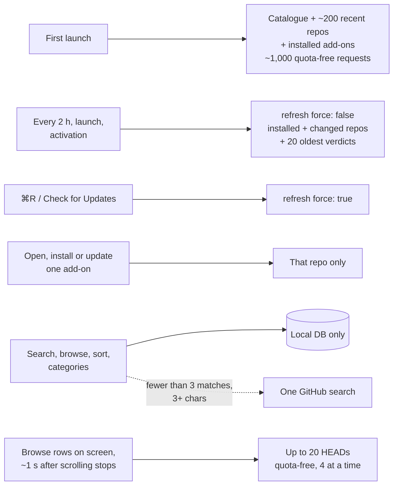

# Network overview

When Reload uses the network, and the rules every request follows. Read this before touching anything that makes requests.

Why it works this way: [decision 0009](../decisions/0009-local-first-search.md) (local-first search) and [decision 0010](../decisions/0010-quota-free-endpoints.md) (quota-free endpoints). The refresh itself is in [features/refresh.md](../features/refresh.md).

## When the network is used

| Trigger | What's fetched |
|---|---|
| First launch (no completed refresh) | Catalogue, a seed of the top ~200 recently updated repos that have `release.json`, plus installed add-ons. About 1,000 requests, ~25 s at concurrency 4, 0 API calls. Shown behind the [seeding sheet](../app/first-launch.md) |
| Every 2 hours, launch, app activation | Installed add-ons, repos whose catalogue `last_updated` changed, repos new to the catalogue, and the 20 oldest verdicts past 14 days. Answers still within their lifetime are skipped. About 5 + N quota-free requests. Skipped entirely if the last refresh finished under 2 h ago |
| ⌘R, toolbar, menu bar extra | The same refresh, forced: installed add-ons re-checked with `.forceRevalidate`, catalogue revalidated; never re-seeds |
| Opening an add-on's details | 2–4 quota-free requests for that repo, only if stale; no API calls, no zips. Release notes are one API call, on demand ([details](../features/details-and-screenshots.md#release-notes)) |
| Install, update, adopt | That add-on's latest tag, `release.json` and zip (quota-free on the stable channel); the API release list otherwise |
| Refresh with WoWInterface or Tukui on | Their listings when older than 24 h, or on ⌘R: one request each (WoWInterface ~5.6 MB). Installed hosted add-ons' latest files at most hourly, one request per host for all of them; a new version's zip once ([sources.md](../features/sources.md)) |
| Rollback | Nothing: it reinstalls from the download cache and pins, no re-check |
| Search, browse, sort, categories | Nothing, except the automatic [GitHub fallback](../features/search.md#github-fallback). A hosted listing never downloaded is left to the refresh ([sources.md](../features/sources.md#freshness)) |
| Browse rows on screen, ~1 s after scrolling stops | [Visible-row checks](../features/refresh.md#visible-row-checks): for up to 20 rows without a fresh answer, `HEAD releases/latest` plus a new tag's `release.json`. Quota-free, 4 at a time; never during a refresh, on Low Data Mode or while github.com is pushing back |
| Store-watcher reload, activation reload | Nothing |

Automatic refreshes can be turned off in Settings (**Check for updates automatically**).

## Principles

- **Local first.** UI reads come from the SQLite database ([data-storage.md](../architecture/data-storage.md)).
- **Prefer quota-free endpoints.** `github.com/{owner}/{repo}/releases/latest` redirects, `releases/download/…` assets and `raw.githubusercontent.com` cost no API quota ([github-endpoints.md](github-endpoints.md)).
- **Respect the quota.** The REST API allows 60 calls an hour per IP without a token (shared by everything on that IP), 5,000 with one. Keep a reserve of 10 calls for installs and updates, stop once the limit is hit, and store the rate-limit state.
- **Cache everything, failures included**, with a TTL. Use ETags. Never refetch what's stored and fresh ([caching.md](caching.md)).
- **One owner per kind of data.** Callers state intent with a `CachePolicy`; they never bypass the owner ([decision 0011](../decisions/0011-single-cache-owner.md)).
- **Be polite.** At most 4 concurrent requests to github.com, with jitter. Honour `retry-after` and back off on 429 and 403.
- **Background work stays off Low Data Mode networks** (`allowsConstrainedNetworkAccess = false`).
- **No keys shipped.** Users may add their own GitHub token in Settings or with `reload config set github-token`.

## Related

- [app/network-activity.md](../app/network-activity.md): watch every request live (Window ▸ Network Activity)
- [github-endpoints.md](github-endpoints.md): every URL, headers and error mapping
- [caching.md](caching.md): TTLs, ETags, negative caching
- [budget.md](budget.md): requests per user action, measured
