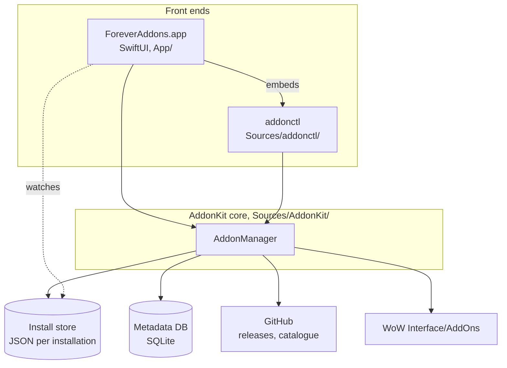

# Overview

What ForeverAddons is, its three parts (the app, the CLI and the core), and how they fit together.

## What it is

A native macOS add-on manager for **World of Warcraft: Forever**, written in Swift. It finds add-ons, tells you whether each one supports your game (Forever first; Retail and the classic games work too), and installs, updates, pins, rolls back and removes them safely.

- **Forever first.** Every rule is checked against how Forever is packaged: interface `16xxx`, `_Camelot` / `-Forever` TOC suffixes. Retail and the classic games use the same machinery, each with its own rules ([flavors.md](architecture/flavors.md)).
- **No API keys.** Add-ons come from GitHub Releases. Users may add their own GitHub token to raise rate limits ([decision 0002](decisions/0002-github-releases-no-keyed-apis.md)).
- **Safe on disk.** Installs are transactional, removed add-ons go to the Trash, and folders the app doesn't manage are never overwritten without asking ([installing.md](features/installing.md)).
- **Local first.** Search and browse read a local database; the network is used on a schedule and on demand ([network/overview.md](network/overview.md)).

## The three parts

| Part | What it does | Docs |
|---|---|---|
| **App** (`App/`) | SwiftUI window with Installed and Browse tables, an inspector, Settings and a menu bar extra. Bundles the CLI | [app/](app/project.md) |
| **CLI** (`addonctl`) | Package-manager-style commands (`search`, `install`, `update`, `outdated`, …) with `--json` and exit codes | [cli/](cli/commands.md) |
| **Core** (`AddonKit`) | All logic: finding WoW, choosing releases, downloading, installing, the store, search | [architecture/core.md](architecture/core.md) |

## How they fit

- **One core, one state.** The app and the CLI both call `AddonManager` and share one install store and one metadata database. An add-on installed from the terminal shows up in the app, and the reverse ([decision 0001](decisions/0001-swift-package-core.md)).
- **Safe to run side by side.** Store writes take a cross-process `flock`, and the app watches the store folder and reloads when the CLI changes it ([data-storage.md](architecture/data-storage.md)).
- **Anything the app can do, `addonctl` can do.**
- **Shared credentials.** The GitHub token lives in the Keychain, readable by both.

## A typical install

1. You search "boss" in Browse. Results come from the local catalogue, ranked, with R / F / C games bubbles ([search.md](features/search.md)).
2. You click Install. The core resolves the newest release with a Forever build ([release-selection.md](features/release-selection.md)).
3. The zip is downloaded, validated and swapped into `Interface/AddOns` with backups ([installing.md](features/installing.md)).
4. The record is written to the install store. `addonctl list` shows it at once.

## Where to go next

- Index of every doc: [README.md](README.md)
- Build and test: [development.md](development.md)
- Why things are the way they are: [decisions/](decisions/README.md)
