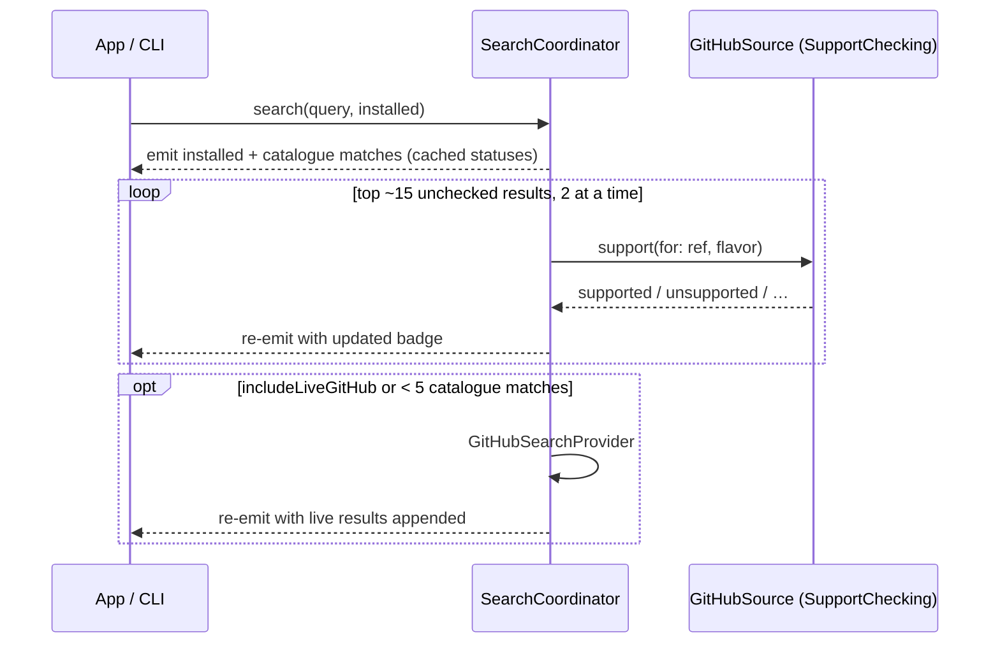

# Search

Search powers the app's Browse tab and `addonctl search`. One query searches several layers, and the results stream back as each layer finishes.

Code: `Sources/AddonKit/Search/`.

## Layers

| Layer | Data | Cost | Runs |
|---|---|---|---|
| Installed | `InstallStore` + unmanaged folders' TOCs | local | always, first |
| Catalogue | [github-wow-addon-catalogue](https://github.com/layday/github-wow-addon-catalogue) `addons.csv` (~2.4k repos) | one raw download per 24 h, no API quota | always |
| Direct ref | query looks like `owner/repo` or a GitHub URL | none | immediately |
| GitHub live | `api.github.com/search/repositories` | 10 searches/min without a token | when asked, or when the catalogue finds fewer than 5 |

## How a search runs

- Results are deduplicated by ref, and their `origin` sets are merged.
- Cancelling the consumer cancels any work still running.
- **Forever only** (on by default) hides `.unsupported` and `.noReleases` results. Installed add-ons and direct refs always stay.

## Matching and ranking (`SearchIndex`)

- **Matching:**
  - Case and accents are ignored.
  - Words are split on punctuation and camelCase, so "boss" matches DeadlyBossMods.
  - Every query word must match a word in the name, owner, repo or description. The last word may match as a prefix.
  - **Aliases:** `dbm`, `bw`, `lw`, `wa`/`wa2`, `tsm`, `bt4`, `rcl`, `mrt`, `ert`, `elv`, `bossmods`. They're defined in `SearchAliases.swift`.
- **Ranking**, highest first:
  1. Exact name match
  2. Name starts with the query
  3. All words in the name
  4. Match in the description

  Within each tier, results sort by support (supported, then unknown, then unsupported), then by most recently updated.

Known quirk: "bag" ranks the Bagnon plugins above BetterBags, because a name starting with the query outranks a word inside a camelCase name.

## Caches

| What | File | Lifetime |
|---|---|---|
| Parsed catalogue | `<caches>/catalogue.plist` (binary plist, with ETag) | 24 h; a stale copy is used if the network fails |
| Support statuses | `<caches>/forever-support.json`, keyed by ref + game version | 6 h; `.checking` and `.unknown` are never saved |
| Live GitHub results | in memory, per query | 10 min |

## Live GitHub search

`q=<terms> in:name,description topic:wow-addon`, sorted by recently updated, 30 per page.
- If that finds fewer than 5 results, it retries with `topic:world-of-warcraft-addon`, then with no topic but with `wow OR warcraft` added to the terms.
- Archived repos and forks are dropped.
- A rate limit stops this layer quietly; the rest of the search continues.

## Browse (empty query)

`AddonManager.browse(in:)` returns:
- **Popular:** add-ons already confirmed to support Forever, sorted by stars when known.
- **Recently updated:** catalogue entries with the newest update dates.
- **Categories:** Boss mods, Bags, UI, Quests, Maps, Auction and Combat. Each is a saved keyword query from `SearchAliases.categories`.

Results that are already installed are marked.
