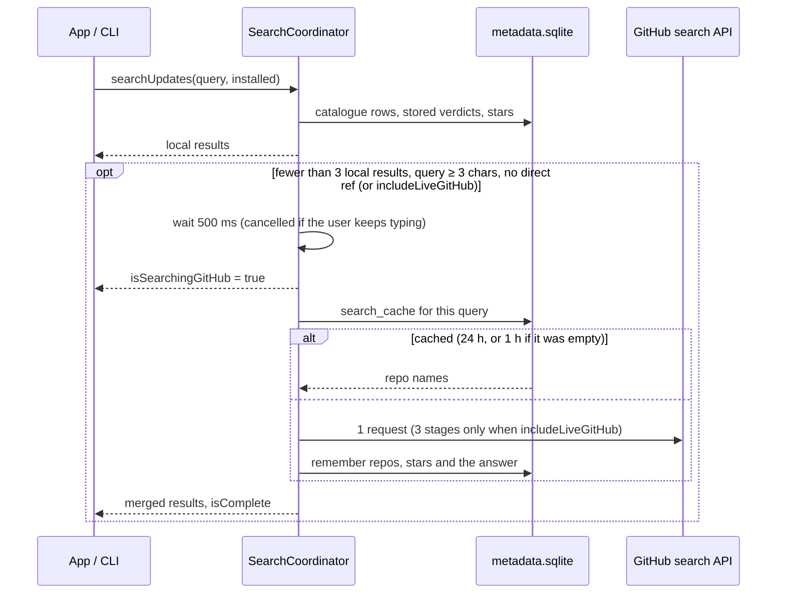

# Search

Search powers the app's Browse tab and `addonctl search`.

**Search reads the local database; if it finds nothing, it asks GitHub once and remembers the answer.** Other network work happens on first launch, every 2 hours, and when you open, install or update a specific add-on (see [Refresh](#refresh)).

Code: `Sources/AddonKit/Search/`, `Store/MetadataDatabase.swift`.

## Layers

| Layer | Data | Network |
|---|---|---|
| Installed | `InstallStore` + unmanaged folders' TOCs (or the list the caller passes) | none |
| Direct ref | query looks like `owner/repo` or a GitHub URL | none |
| Catalogue | `catalogue` table: [github-wow-addon-catalogue](https://github.com/layday/github-wow-addon-catalogue) rows plus repos earlier live searches found | none, except the very first download if the database is empty |
| GitHub live | `api.github.com/search/repositories` | only as the fallback below, or when `includeLiveGitHub` is set |

## How a search runs

- **No support checks during search.** Results carry the stored verdict. Catalogue rows without a `release.json` show `.needsDownload`, since nothing cheaper could tell. Everything else is `.unknown` until it's opened, installed or refreshed. `.checking` is never emitted.
- `search(_:installed:)` returns plain result arrays; `searchUpdates(_:installed:)` returns `SearchUpdate { results, isSearchingGitHub, isComplete }`. `AddonManager` has both, plus `search(_:in:installed:)` so the caller's add-on list is used instead of rescanning `AddOns/` per keystroke.
- Results are deduplicated by ref, and their `origin` sets are merged.
- Cancelling the consumer cancels any work still running.
- **Forever only** (on by default) hides `.unsupported` and `.noReleases` results. Installed add-ons and direct refs always stay.
- **Live search limits:** the search API allows 10 requests a minute without a token, 30 with one. Its remaining count and reset time are stored in `rate_limit` (resource `search`), so the CLI and app share them. While none are left the fallback is skipped quietly; a 403 with no reset header waits 60 s.

## Matching and ranking (`SearchIndex`)

The in-memory `SearchIndex` is built from one `SELECT` of the catalogue table, and rebuilt only when the rows change. FTS5 is available in the system SQLite, but it can't reproduce these tiers and both take under 2 ms, so ranking stays in Swift.

- **Matching:**
  - Case and accents are ignored.
  - Words are split on punctuation and camelCase, so "boss" matches DeadlyBossMods.
  - Every query word must match a word in the name, owner, repo or description. The last word may match as a prefix.
  - **Aliases:** `dbm`, `bw`, `lw`, `wa`/`wa2`, `tsm`, `bt4`, `rcl`, `mrt`, `ert`, `elv`, `bossmods`. They're defined in `SearchAliases.swift`.
- **Ranking**, highest first:
  1. Exact name match
  2. Name starts with the query
  3. All words in the name
  4. Match in the description

  Within each tier, results sort by support (supported, then unknown, then unsupported), then by most recently updated.

Known quirk: "bag" ranks the Bagnon plugins above BetterBags, because a name starting with the query outranks a word inside a camelCase name.

## The catalogue (`CatalogueSource`)

- **Download:** one raw.githubusercontent.com request (no API quota), at most every 24 h, revalidated with `If-None-Match`.
- **Stale while revalidating:** an old copy is returned at once and refreshed in the background.
- **Offline:** a failed download isn't retried for 15 minutes. The failure time is stored, so the app and CLI share the backoff.
- **Import:** all rows are upserted in one transaction. `ON CONFLICT … DO UPDATE … WHERE (columns) IS NOT (new values)` leaves unchanged rows alone, so `refresh()` returns a `CatalogueDiff` of the repos that actually changed. Rows that left the file are deleted; rows found by live search (`source = 'github_search'`) are kept.

## Browse (empty query)

`AddonManager.browse(in:)` is local only:
- **Popular:** add-ons with a stored "supported" verdict, sorted by stars when known.
- **Recently updated:** catalogue entries with the newest update dates.
- **Categories:** Boss mods, Bags, UI, Quests, Maps, Auction and Combat. Each is a saved keyword query from `SearchAliases.categories`.

Results that are already installed are marked.

## Metadata database

`<applicationSupport>/metadata.sqlite`, through `MetadataDatabase` ([core.md](core.md#metadata-database)). It's Application Support rather than Caches because it holds state worth keeping: verdicts, refresh times and remembered searches.

| Table | Key | Holds |
|---|---|---|
| `catalogue` | `full_name` (no case) | catalogue rows; `source` is `catalogue` or `github_search`; `first_seen_at`, `changed_at` |
| `catalogue_state` | single row | ETag, last fetch, last failure |
| `support` | `full_name` + `flavor` | verdict (`supported`, `unsupported`, `noReleases`, `needsDownload`, or `error`), version, the tag it was based on, `checked_at` |
| `repo_meta` | `full_name` | latest tag and when it was seen, publish date if known, stars, README path and ETag |
| `details` | `full_name` + `flavor` | README, screenshot URLs, latest release notes for the inspector |
| `refresh_state` | installation ID | last refresh time and the update states it found |
| `search_cache` | normalised query | repos a live search returned, and when |
| `rate_limit` | `core` / `search` | remaining calls and reset time |

- `catalogue` and `support` are `WITHOUT ROWID` tables; `catalogue(last_updated)` and `support(flavor, checked_at)` are indexed for the refresh queries.
- **Verdict lifetimes:** a verdict is shown as long as it's stored. It's re-checked when the catalogue says the repo changed after `checked_at`, when it's older than 24 h and someone opens the add-on, or as part of a refresh's rotating slice (older than 14 days). An `error` row only stops retries for 15 minutes and is never shown.
- **Migrations:** ordered SQL steps; `PRAGMA user_version` counts how many have run. Each new step runs in its own `BEGIN IMMEDIATE` transaction on open, re-checking the version inside the lock so the app and CLI can't both apply it.
- **Changes:** `MetadataDatabase.changes()` streams the tables and repos each commit touched, so the UI can patch only affected rows. Writes from another process don't appear there; compare `dataVersion()` on app activation instead.
- Earlier versions kept `catalogue.plist` and `forever-support.json` in Caches. They're no longer read or written.
